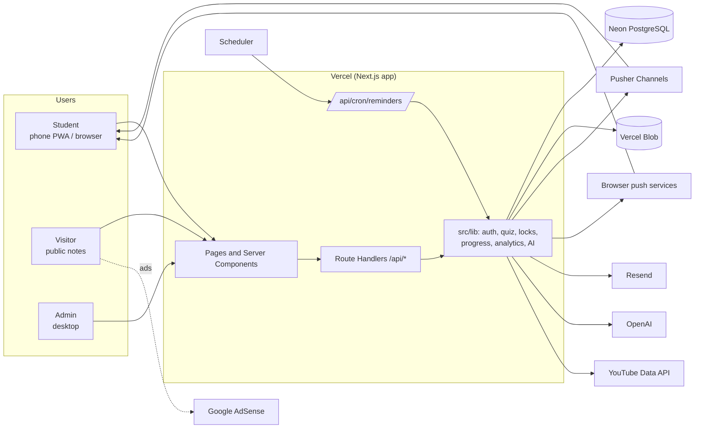
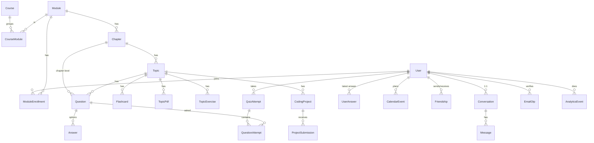
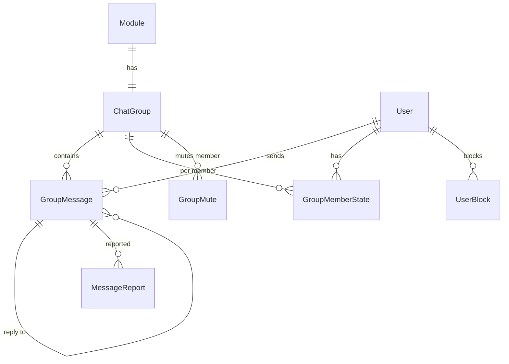

# Tyro Study: Technical architecture and planning

*Phase 4 of the project lifecycle. Written 29 October 2026 from the codebase (`package.json`, `prisma/schema.prisma`, `src/app/api`, `src/lib`), the requirements (`02-requirements.md`) and the design (`03-ux-ui-design.pdf`).*

> **How to read this.** Tyro is already in production, so this document records the architecture as it is, judges each decision, and plans the changes the requirements and design need. Every section ends with **decisions** (what we keep or change) and, where it matters, **gaps** found in the code. Diagrams are Mermaid, so they render on GitHub and in VS Code.

---

## 1. Summary

| Area | Decision |
|---|---|
| Shape | **Modular monolith**: one Next.js app (UI + API routes) on Vercel. No microservices. |
| Frontend | Next.js 16 (App Router), React 19, TypeScript strict, Tailwind CSS 4, Radix primitives, Zustand, PWA (`next-pwa`) |
| Backend | Next.js Route Handlers (Node runtime) and Server Components; business logic in `src/lib` |
| Database | PostgreSQL on **Neon** through Prisma 7 (`@prisma/adapter-pg`, pooled for the app, direct for migrations) |
| Files | **Vercel Blob** (avatars, chat media, topic PDFs, textbooks) |
| Real time | **Pusher Channels** (chat, typing, presence) and **Web Push** (VAPID, own implementation) |
| Email | **Resend** from `no-reply@tyrostudy.co.za` |
| AI | **OpenAI** (`gpt-4o-mini` by default, set by `OPENAI_MODEL`) behind `src/lib/ai/*` |
| Auth | NextAuth 4, credentials provider, JWT sessions in an httpOnly cookie; email OTP for sign-up |
| Analytics | First-party events table (`analytics_events`) + `/admin/analytics` |
| Next big changes | Fix data-protection gaps (section 6.4), add error tracking and backups (section 7), module group chats (section 4.4), move long AI jobs to a background queue (section 5) |

---

## 2. System overview



**Request path.** The browser calls a page or `/api/*`. `src/proxy.ts` (Next.js middleware) redirects signed-out users away from app pages. Each route handler checks the session itself, then calls `src/lib` for the logic and Prisma for data. Side effects (Pusher, push, analytics) run after the main write, and their failures never undo it.

### 2.1 Code layout

| Folder | Holds |
|---|---|
| `src/app/(auth)` | Login, register, forgot and reset password |
| `src/app/(dashboard)` | The signed-in app: dashboard, modules, topics, quizzes, timetable, chat, profile, admin |
| `src/app/notes`, `about`, `privacy`, `terms` | Public, indexable pages |
| `src/app/api/*` | ~90 route handlers (section 4.2) |
| `src/lib` | Domain logic: `topic-locks`, `quiz-stats`, `streak`, `reminders`, `levels`, `email-otp`, `analytics*`, `ai/*` |
| `src/components` | UI by area (`quiz`, `chat`, `admin`, `ui`…) |
| `src/prisma` | Generated Prisma client (committed) |
| `prisma/` | Schema and 23 migrations |

---

## 3. Technology choices

| Layer | Chosen | Alternatives considered | Why |
|---|---|---|---|
| Framework | **Next.js (App Router)** | React SPA + separate .NET API (an earlier plan); Remix | One language (TypeScript) end to end, server rendering for SEO of public notes (AdSense needs real content), one deploy. The team is one developer. |
| Language | **TypeScript strict** | – | Shared types between UI and API; catches contract breaks at build time |
| Database | **PostgreSQL (Neon)** | MySQL, Firebase/Firestore, MongoDB | Relational data (module → chapter → topic → question), joins for progress and analytics, JSONB where needed. Neon: serverless, branching, point-in-time restore, pooled connections for Vercel. |
| ORM | **Prisma 7** (driver adapter) | Drizzle, raw `pg` | Typed queries and migrations. Raw SQL is used where columns were added after the client (`locked`, `published`, `isSuperuser`) so code works before `prisma generate`. |
| Hosting | **Vercel** | Render, Fly.io, Azure App Service | Built for Next.js, preview deploys, instant rollback, Blob storage in the same account |
| Real time | **Pusher Channels** | Ably, Supabase Realtime, own WebSocket server | Serverless functions can't hold sockets; a managed service is simplest |
| Email | **Resend** | SES, Postmark | Simple API, domain already verified |
| AI | **OpenAI** behind `lib/ai` | Anthropic Claude, Google Gemini | Already integrated. All calls go through `chatJson()` and `getOpenAIClient()`, so swapping or adding a provider is a contained change. |
| Styling | **Tailwind 4** + CSS variables (`--neo-*`) | CSS modules | Matches the design tokens in `03-ux-ui-design.pdf` |

**Decision:** keep the stack. There is no part of the product that needs a second language or runtime today. Revisit a separate service (for example .NET or Python workers) only for heavy, long-running jobs such as textbook OCR at scale, and then as a worker, not a rewrite.

---

## 4. Data and API design

### 4.1 Database schema

**Conventions:** `cuid()` string ids; tables in snake_case through `@@map` (with exceptions, see gaps); timestamps stored as UTC `TIMESTAMP(3)`; days for streaks and analytics counted in Africa/Johannesburg in SQL.



| Group | Tables | Notes |
|---|---|---|
| Identity | `users`, `accounts`, `sessions`, `verification_tokens`, `email_otps` | `accounts`/`sessions` exist for the NextAuth adapter but sessions are JWT, so `sessions` stays empty. `verification_tokens` holds password-reset tokens. OTP codes are stored hashed. |
| Catalogue | `courses`, `course_modules`, `modules`, `chapters`, `topics`, `topic_pdfs` | `modules.level` and `courses.level` split university and high school. `topics.locked`, `topics.published` drive locks and public notes. |
| Content | `questions`, `answers`, `flashcards`, `topic_exercises`, `coding_projects` | `questions.kind` = `mcq` or blank; `questions.paper` marks past-paper questions; `questions.studyNote` caches AI notes. |
| Learning activity | `quiz_attempts`, `question_attempts`, `user_answers`, `project_submissions`, `Assignment_Attempt` | Each attempt stores a copy of its questions (`questionsData`) so content edits never break an open quiz. |
| Planning | `calendar_events` (current), `timetable`, `notifications` (older) | Reminders use `calendar_events.remindAt/remindedAt`. |
| Social | `Friendship`, `Conversation`, `Message`, `PushSubscription` | To be replaced by module groups (section 4.4). |
| Analytics | `analytics_events` | Added 29 Oct 2026. Deleted with the user. |

**Gaps found in the schema**

| # | Gap | Risk | Fix |
|---|---|---|---|
| S1 | `PushSubscription.userId` and `Assignment_Attempt.userId/topicId` have **no foreign key**. | Rows survive account deletion (POPIA), orphan rows | Add relations with `onDelete: Cascade` in a migration (clean orphans first) |
| S2 | JSON kept as `String` (`quiz_attempts.questionsData`, `settings`; `project_submissions.files`; `topic_exercises.blanks`). Code searches settings with `LIKE '%"source":"chapter:…"%'`. | Slow, fragile queries as attempts grow | Move to `Json` (JSONB) and add real columns for what is queried: `quiz_attempts.kind` and `quiz_attempts.chapterId` with an index |
| S3 | Mixed table naming (`Friendship`, `Message`, `PushSubscription`, `Assignment_Attempt` have no `@@map`). | Confusing raw SQL | Map to snake_case when those tables are next touched |
| S4 | `level` and `CalendarEvent.type` are free strings, not enums. | Bad values possible | Prisma enums (or a DB check constraint) |
| S5 | `timetable` and `notifications` look superseded by `calendar_events`. | Dead code and data | Confirm, migrate any rows, drop |
| S6 | No index on `topics.published` or `quiz_attempts(userId, status)`. | Slower public pages and resume | Add when the tables grow (check with `EXPLAIN`) |

### 4.2 API contracts (current)

All APIs are JSON over HTTPS under `/api`, same origin, authenticated by the session cookie. Errors use `{ "error": "message" }` with standard status codes (400 invalid, 401 not signed in, 403 forbidden or locked, 404, 409 conflict, 429 limit, 500/503).

| Area | Endpoints | Who |
|---|---|---|
| Auth | `POST /auth/register` → `POST /auth/register/verify` (+ `/resend`), `POST /auth/forgot-password`, `POST /auth/reset-password`, NextAuth at `/auth/[...nextauth]` | Public |
| Catalogue | `GET/POST /modules`, `GET/PATCH/DELETE /modules/{id}`, `POST /modules/{id}/publish`, `GET/POST /courses`, `/chapters`, `/topics`, `/topics/{id}` | Read: students (by level); write: admins |
| Enrolment | `GET/POST /enrollments`, `DELETE /enrollments/{moduleId}` | Student |
| Quizzes | `POST /quiz/attempt` (start or resume), `GET /quiz/attempt?attemptId=` , `PUT /quiz/attempt` (answer or finish), `GET /quiz/next`, `/quiz/notes` | Student |
| Practice | `POST /exercises/{id}/check`, `POST /projects/{id}/submit`, `POST /assignment/grade` | Student |
| Progress | `GET /progress/module/{id}`, `/progress/modules`, `/progress/topic/{id}`, `/progress/user/{id}` | Student (own), admin (any) |
| Planning | `GET/POST /calendar`, `PATCH/DELETE /calendar/{id}`, `/timetable` | Student |
| Social | `/chat/friends`, `/chat/conversations`, `/chat/messages`, `/chat/read`, `/chat/typing`, `/chat/upload`, `/chat/unread-count`, `/presence`, `/pusher/auth` | Student |
| Push | `GET /push/public-key`, `POST /push/subscribe`, `POST /push/test` | Student |
| Profile | `GET/PATCH /profile`, `/profile/avatar`, `/profile/email` (+ `/resend`), `/profile/password` | Student |
| Admin content | `/admin/textbooks/*` (upload, ocr, analyze, create, generate-topic), `/admin/papers/*`, `/ai/*` (generate lesson, questions, flashcards, extract, find video), `/questions/*`, `/flashcards/import`, `/admin/templates/*` | Admin |
| Admin users | `GET /admin/users`, `PATCH/DELETE /admin/users/{id}`, `POST /admin/users/{id}/reset-password`, `POST /admin/superuser/claim` | Admin / superuser |
| System | `GET /cron/reminders` (CRON_SECRET), `POST /events` (analytics) | Scheduler / browser |

**Key contract: quiz attempt** (the most important flow)

```http
POST /api/quiz/attempt
{ "topicId": "…" }            // or chapterId, moduleId (mock exam), questionIds; "fresh": true to restart
→ 200 { success, data: { attemptId, questions: [{ id, text, difficulty, kind, options: [{ id, text }] }], settings, startedAt } }
→ 403 { error, locked: true, previousTopic: { id, title }, passMark: 70 }

PUT /api/quiz/attempt
{ "attemptId": "…", "questionId": "…", "selectedAnswerId": "…" }   // or "typedAnswer", or "finish": true
→ 200 { completed: false, isCorrect, correctAnswerId, progress: { answered, total } }
→ 200 { completed: true, score, passed, passingScore, correctCount, durationSeconds, timedOut, review: [...] }
```

Rules the contract guarantees: correctness is decided on the server and anything the client sends about it is ignored; typed-answer solutions are never sent to the browser; late answers past the time limit plus 2 minutes are refused.

**Decisions for the API**

1. **Validate every body with a schema** (Zod) in one helper, instead of hand-written `typeof` checks. Same helper returns the `{ error }` shape.
2. **One auth helper per role**: `requireUser()`, `requireAdmin()`, `requireSuperuser()`. Today some routes read `session.user.email`, others `session.user.id`; standardise on the id.
3. **Version only when needed.** The API is private to the app, so no `/v1` prefix; breaking changes ship with the UI in the same deploy.
4. **Document contracts as TypeScript types** in `src/types/api.ts`, shared by routes and components.

### 4.3 Schema and API additions for the planned features

| Feature (requirement) | Schema | API |
|---|---|---|
| Onboarding (FR-12) | `users.onboardedAt`, `users.dailyGoalMinutes`, `users.reminderTime` | `PATCH /profile` (extended), `POST /enrollments/bulk` |
| Explanation per answer (FR-32) | `questions.explanation` (text) | Returned by `PUT /quiz/attempt` after each answer; `POST /admin/questions/explain` batch job |
| Report a question (FR-37) | `question_reports (id, questionId, userId, reason, status, createdAt)` | `POST /questions/{id}/report`, admin list |
| Spaced repetition (FR-41) | `card_reviews (userId, flashcardId, ease, intervalDays, dueAt, lastReviewedAt)` unique per user + card | `GET /review/due`, `POST /review/{flashcardId}` `{ rating: again|hard|good|easy }` |
| Streak counts study (FR-51) | `users.lastStudyDate` (keep `lastVisitDate` for presence) | Updated inside lesson-complete and quiz-pass handlers |
| Self-service deletion (FR-07) | – (relies on cascades, gap S1) | `DELETE /profile` with password confirmation |
| Content ready state (FR-86) | `topics.status` = `draft` / `ready` | Students only see `ready` topics |

### 4.4 Module group chats (FR-63 to FR-6B)



| Table | Columns (main) | Why |
|---|---|---|
| `chat_groups` | `id`, `moduleId` (unique), `pinnedMessageId`, `createdAt` | One per module, created with the module |
| `group_messages` | `id`, `groupId`, `senderId`, `type`, `content`, `mediaUrl`, `mediaDuration`, `replyToId`, `mentions` (text[]), `deletedAt`, `deletedById`, `createdAt`; index `(groupId, createdAt)` | Soft delete so moderation shows "removed" |
| `group_member_state` | `groupId`, `userId`, `lastReadAt`, `notify` (`mentions` / `all` / `mute`) | Unread counts and notification setting. **Membership itself is the enrolment** (BR-72), so there's no separate member list to keep in sync. |
| `message_reports` | `id`, `messageId`, `reporterId`, `reason`, `status`, `resolvedById`, `createdAt` | Moderation queue |
| `user_blocks` | `blockerId`, `blockedId` | Hide messages client-side and server-side |
| `group_mutes` | `groupId`, `userId`, `until`, `byId` | Timed mute by admins |

**API:** `GET /groups` (my groups with unread counts), `GET /groups/{id}/messages?before=` (pages of 50), `POST /groups/{id}/messages`, `POST /groups/{id}/read`, `PATCH /groups/{id}/settings`, `POST /messages/{id}/report`, `POST /users/{id}/block`, admin: `DELETE /messages/{id}`, `POST /groups/{id}/mutes`, `POST /groups/{id}/pin`, `GET /admin/reports`.

**Real time:** one private channel per group, `private-group-{groupId}`, authorised in `/api/pusher/auth` by checking enrolment. Typing uses client events on the same channel. **Do not use a presence channel per group**: Pusher presence channels are limited to 100 members. "38 online" comes from `users.lastSeen` within the last 5 minutes, counted on the server and cached for 60 seconds.

**Rate limit:** 10 messages per minute per user per group (BR-73), enforced in the POST handler with a count query on `group_messages`; move to a shared store (for example Upstash Redis) if it becomes hot.

**Migration from 1:1 chat:** ship groups behind a flag, then switch off `/chat/friends` and conversations (FR-6B), keep old messages read-only for an agreed period (open question 6), then delete them.

---

## 5. Monolith or microservices

**Decision: stay a modular monolith.**

| Factor | Monolith (chosen) | Microservices |
|---|---|---|
| Team size | One developer: one repo, one deploy | Many services to run alone |
| Scale | Thousands of students; Vercel functions scale per request | Not needed at this size |
| Consistency | One database, transactions where needed | Distributed data, eventual consistency |
| Cost | One Vercel project, one database | More infrastructure and monitoring |

**Keep it modular** so pieces can move out later without a rewrite:

1. Domain logic lives in `src/lib/<area>` with no imports from `app/` (already mostly true).
2. Route handlers stay thin: parse, authorise, call `lib`, respond.
3. **Background jobs** are the one thing to split from the request path. Today long AI work (textbook analysis, bulk generation, explanations) runs inside requests with `maxDuration` 60–120 s. Move these to a job queue (options: Vercel Queues, Upstash QStash, Inngest) with jobs that are retried, idempotent and report progress to the admin UI. This is a worker, not a microservice: same code base, same database.
4. **Scheduled work** (reminders, cleanup, retention deletes) runs from one scheduler (section 7.4).

---

## 6. Authentication, authorisation and data protection

### 6.1 Authentication

```mermaid
sequenceDiagram
  participant B as Browser
  participant A as /api/auth
  participant D as Database
  participant R as Resend
  B->>A: POST /register {name,email,password,level}
  A->>D: bcrypt(password, 12); store OTP hash + payload (10 min)
  A->>R: email 6-digit code
  B->>A: POST /register/verify {email, code}
  A->>D: check hash, attempts ≤ 5; create user
  B->>A: sign in (credentials)
  A->>B: JWT in httpOnly cookie (Secure, SameSite=Lax)
```

- **Session:** NextAuth JWT strategy. The token holds `id`, `role`, `level`. Cookie name and flags are shared with the middleware (`lib/auth-cookies.ts`); Secure in production.
- **Password reset:** random 32-byte token in `verification_tokens`, 1-hour expiry, emailed link.
- **Email change:** re-verified with an OTP.

**Gaps and decisions**

| # | Gap | Decision |
|---|---|---|
| A1 | No rate limit on sign-in attempts. | Limit by email and by IP (for example 5 per 15 minutes) with a small store (Upstash Redis or a DB table); show a generic error. |
| A2 | The JWT keeps `role` until the user signs in again (or the profile calls `update`). Admin routes recheck the database, but some student routes read `session.user.role` (for example skipping topic locks). | Read role from the database (cached per request) wherever it grants extra rights; shorten session `maxAge` to 7 days with sliding renewal. |
| A3 | No way to sign out other devices or revoke a session. | Add `users.tokenVersion`; include it in the JWT and reject tokens with an old version. Bump it on password change and admin "force sign out". |
| A4 | No 2FA for admins. | Add email OTP at admin sign-in (reuses `email_otps`). |

### 6.2 Authorisation

| Layer | How |
|---|---|
| Pages | `src/proxy.ts` blocks signed-out users from app paths; `(dashboard)/admin/layout.tsx` checks the role in the database |
| APIs | Every handler checks the session; admin handlers call `requireAdmin()` (database role); superuser actions call `canManageAdmins()` / `isSuperuser()` |
| Data | Queries are scoped by `userId` (own attempts, own events, own enrolments); conversations checked for membership |
| Content rules | Study level filters the catalogue; topic locks checked on topic fetch, quiz start, exercise check, project submit |
| Real time | `/api/pusher/auth` allows only `presence-online`, the user's own `private-user-{id}`, and conversations they belong to; everything else 403 |

**Decision:** keep authorisation in code (no RBAC library needed for three roles), but put the checks in the shared helpers from section 4.2 and add tests for "student can't call admin route" and "can't read another user's attempt".

### 6.3 Data protection (POPIA)

| Control | Current | Plan |
|---|---|---|
| In transit | HTTPS everywhere (Vercel, Neon TLS) | Add HSTS and security headers (CSP, X-Content-Type-Options, Referrer-Policy, frame-ancestors) in `next.config.ts` |
| At rest | Provider encryption (Neon, Vercel Blob) | – |
| Secrets | Environment variables; `.env*` git-ignored | Separate keys per environment; rotate on any leak (section 7.5) |
| Passwords and codes | bcrypt cost 12; OTPs hashed | – |
| Minimisation | Analytics props carry ids and scores only, no query strings | Same rule for logs (no emails, message text or tokens) |
| Files | Blob `access: "public"` with random paths | Acceptable for avatars; for chat media move to private blobs served through a signed URL route, especially once high school users are in groups |
| Retention | Kept while the account is active | Define: chat messages (NFR-35), quiz history while active, logs 30 days, analytics events 24 months then aggregate |
| Deletion | Email request; most tables cascade from `users` | Fix gap S1, then self-service `DELETE /profile`; delete Blob files the user uploaded |
| Cross-border | Neon (us-east-1), Vercel, Pusher, Resend, OpenAI outside SA; listed in the Privacy Policy | Keep the subprocessor list current; check Neon/Vercel regions closer to SA if latency or policy requires |
| Minors | High school level exists | Group chats keep levels apart; moderation before promoting high school; parental consent wording for under-18s |
| AI | Student code sent to OpenAI for marking | Strip names and emails from prompts; state it in the Privacy Policy (done) |

### 6.4 Gaps to fix first

1. **S1** cascade on `PushSubscription` and `Assignment_Attempt` (deletion and POPIA).
2. **A1** sign-in rate limit.
3. **Security headers** (6.3).
4. **Zoom block** in `layout.tsx` (accessibility, from the design document).

---

## 7. Operations: logging, backups, scaling and recovery

### 7.1 Logging and monitoring

| Today | Plan |
|---|---|
| `console.log/warn/error` → Vercel function logs (short retention on the current plan) | A tiny `logger` in `src/lib/log.ts` that writes JSON lines `{ level, msg, route, userId?, requestId, ms }`, never personal data |
| No error tracking | **Sentry** (or similar) for server and client errors, with source maps and release tags |
| No uptime check | External uptime monitor on `/` and a new `/api/health` (DB ping, returns 200/503) every minute, alerting by email/WhatsApp |
| Product analytics in `analytics_events` | Keep; add Vercel Speed Insights for real-user performance (NFR-01) |
| No log drain | Optional later: drain logs to a store with 30-day retention |

**Alerts that matter:** error rate spike, `/api/health` failing, sign-up OTP send failures (Resend), OpenAI failures, Pusher connection limit warnings, database storage nearing the plan limit.

### 7.2 Backups

| Data | Backup | Restore test |
|---|---|---|
| Neon database | Neon point-in-time restore (window depends on the plan; check it covers at least 7 days) | Once per semester: restore to a branch and run the app against it |
| Database, off-provider copy | Weekly `pg_dump` from a GitHub Action, encrypted, stored outside Neon (for example a private bucket), kept 8 weeks | Restore into local Docker Postgres quarterly |
| Before every migration | Create a Neon branch named `pre-<migration>` | Drop after a week if all is well |
| Vercel Blob files | Not versioned today | Nightly job listing blobs and copying new ones to a second bucket; or accept loss for chat media and back up only topic PDFs and textbooks |
| Code and migrations | Git (push to a remote) | – |
| Secrets | Password manager entry with every environment variable | – |

### 7.3 Scalability

Expected load: a few thousand students, with peaks in May–June and October–November exam seasons, mostly on phones.

| Concern | Today | Plan |
|---|---|---|
| Web and API | Vercel functions scale per request | Fine. Keep heavy work out of requests (section 5). |
| Database connections | Pooled URL for the app, single Prisma client per instance | Fine; watch Neon compute size and autosuspend cold starts (first request after idle) |
| Public notes pages | `force-dynamic` (rendered on every request) | Switch to ISR (`revalidate`, for example 1 hour) and revalidate when an admin publishes; faster and cheaper, better for SEO |
| Quiz queries | `LIKE` on `settings` text | Gap S2: real columns and indexes |
| Analytics report | Full scans of `analytics_events` per page view | Fine for now; add a nightly rollup table when events pass ~1 million rows |
| **Pusher presence** | **One global `presence-online` channel for every signed-in user** | **Presence channels allow at most 100 members**, so online status breaks past 100 concurrent users. Replace with `lastSeen` heartbeats (the `/api/presence` route already exists) and drop the global presence channel. |
| Pusher messages | 1:1 chat | Group chat multiplies messages; check the plan's daily message and connection limits before launch |
| AI cost | Admin-triggered generation; student marking limited per day (BR-31) | Track cost per job; cache explanations on questions; never call AI per page view |
| Files | Uploads go to Blob from the server (chat) or client upload (textbooks) | Client uploads for large files everywhere, to stay inside function body limits |

### 7.4 Scheduled jobs

`/api/cron/reminders` is protected by `CRON_SECRET`, but **there is no `vercel.json` cron definition in the repository**, and `CRON_SECRET` isn't in `.env.local`. Confirm what calls it in production (an external pinger or the Vercel dashboard). If nothing does, reminders are not being sent.

**Decision:** add `vercel.json` with the reminders schedule (and later: retention cleanup, analytics rollup, Blob backup) so schedules live in the repo. Check the plan's minimum cron interval; if it's too coarse for reminders, keep an external pinger calling the same protected route.

### 7.5 Failure recovery runbook

| Failure | Users see | Detect | Recover |
|---|---|---|---|
| Bad deploy | Errors after release | Sentry spike, uptime check | Vercel instant rollback to the previous deployment |
| Bad migration | Errors on some pages | Sentry, `migrate status` | Restore the `pre-<migration>` Neon branch or fix forward; code already tolerates missing columns (`orFallback`) |
| Database down / suspended | App errors, sign-in fails | `/api/health` | Neon status; wait or restore; public notes keep working once on ISR |
| Pusher down | Messages arrive on refresh | Pusher status, errors in logs | Nothing to do: messages are saved first (NFR-11) |
| Resend down | No sign-up codes or resets | OTP send errors | Clear message to retry later; optional backup sender |
| OpenAI down or rate-limited | Admin generation and AI marking fail | Errors in `chatJson` | Retries already; queue jobs and retry later; switch `OPENAI_MODEL` or provider |
| Leaked secret | – | GitHub secret scanning, provider alerts | Rotate the key at the provider, update Vercel env, redeploy; rotating `NEXTAUTH_SECRET` signs everyone out |
| Data loss (deleted rows) | Missing content | User report | Point-in-time restore to a branch, copy rows back |
| Spam or abuse in chat | Harmful messages | Reports | Admin delete and mute; rate limits |

**Targets:** recovery time under 1 hour for a bad deploy, under 4 hours for database restore; data loss under 24 hours (better with point-in-time restore).

---

## 8. Environments and delivery

| Environment | Where | Database | Notes |
|---|---|---|---|
| Local | `npm run dev` on port 4000 | Docker Postgres (`docker-compose.yml`) **recommended**; today `.env.local` points at the live Neon database | Use a local database or a Neon dev branch, so local testing can't damage live data |
| Preview | Vercel preview per branch | A Neon branch per preview (Vercel–Neon integration) | Safe place to run migrations first |
| Production | www.tyrostudy.co.za | Neon main | Migrations with `prisma migrate deploy` over the direct URL |

**Pipeline (to add):** GitHub Actions on every push: `npm ci`, `prisma validate`, `tsc --noEmit`, `eslint`, unit tests, `next build`. Block merging on failure. Run `prisma migrate deploy` in the Vercel build step or as a manual, logged step before promoting.

**Testing plan:** unit tests for `lib` rules (topic locks, quiz scoring, streak days, mock exam plan, analytics SQL with an in-memory Postgres such as PGlite); API tests for permissions; a few Playwright end-to-end tests for sign-up → join module → pass a quiz.

---

## 9. Third-party integrations

| Service | Used for | Config (env vars) | Data sent | Limits / cost to watch | If it fails |
|---|---|---|---|---|---|
| Vercel | Hosting, functions, Blob, cron | `BLOB_READ_WRITE_TOKEN`, `APP_URL` | All traffic; uploaded files | Function duration, bandwidth, Blob storage | Rollback; status page |
| Neon | PostgreSQL | `DATABASE_URL` (pooled), `DIRECT_DATABASE_URL` / `DATABASE_URL_UNPOOLED` (migrations) | All app data | Compute hours, storage, restore window | Restore; wait |
| Pusher | Real-time chat, typing, presence | `PUSHER_APP_ID`, `PUSHER_SECRET`, `NEXT_PUBLIC_PUSHER_KEY`, `NEXT_PUBLIC_PUSHER_CLUSTER` | Message payloads, user ids | Connections, messages per day, **100-member presence limit** | Messages on refresh |
| Web Push | Notifications | `VAPID_PUBLIC_KEY`, `VAPID_PRIVATE_KEY`, `VAPID_SUBJECT` | Title and preview text | Expired subscriptions (prune on 404/410) | No notifications |
| Resend | Account email | `RESEND_API_KEY`, `EMAIL_FROM` | Email address, codes, links | Daily send limit; domain reputation | No sign-ups or resets |
| OpenAI | Content generation, marking, notes | `OPENAI_API_KEY`, `OPENAI_MODEL` | Textbook text, questions, student code | Tokens per minute, monthly spend | Retry; admin waits |
| YouTube Data API | Video finder | `YOUTUBE_API_KEY` | Search terms | Daily quota | Admin finds videos by hand |
| Google AdSense | Revenue | `ADSENSE_CLIENT` in `lib/site.ts`, `public/ads.txt` | Cookies, page views (Google) | Policy compliance | No ad income |
| NextAuth | Sessions | `NEXTAUTH_SECRET`, `NEXTAUTH_URL` | – | – | – |
| Scheduler | Reminders | `CRON_SECRET` | – | Minimum interval | Reminders late or missing |
| **Planned:** Sentry, uptime monitor, job queue, Redis (rate limits) | Section 7 | – | Error traces (no personal data) | Free tiers likely enough | – |

---

## 10. Risk register

| # | Risk | Likelihood | Impact | Mitigation | Owner |
|---|---|---|---|---|---|
| R1 | Local development and scripts run against the live database (`.env.local` → Neon main) | High | High | Local Docker DB or Neon dev branch; separate env files | Dev |
| R2 | Global Pusher presence channel fails past 100 online users | Medium (exam season) | Medium | Replace with `lastSeen` heartbeats (7.3) | Dev |
| R3 | Reminders not scheduled (no `vercel.json` cron, no `CRON_SECRET` locally) | Medium | Medium | Confirm and add cron config (7.4) | Dev |
| R4 | Account deletion leaves push subscriptions and assignment attempts (no FK) | High | Medium (POPIA) | Gap S1 migration | Dev |
| R5 | Sign-in brute force | Medium | High | Rate limit (A1) | Dev |
| R6 | Long AI requests time out | Medium | Medium | Background jobs (section 5) | Dev |
| R7 | AI-generated mistakes reach students | Medium | High | Draft/ready state, question reports, explanations reviewed | Content |
| R8 | No error tracking or uptime alerts: outages found by users | High | Medium | Sentry + uptime monitor (7.1) | Dev |
| R9 | Single developer (bus factor 1) | High | High | This document, README runbooks, secrets in a password manager, CI checks | Founder |
| R10 | Vendor cost jump (Vercel, Neon, Pusher, OpenAI) | Medium | Medium | Monthly cost review; analytics cost-per-learner; abstraction around AI and real time | Founder |
| R11 | Public chat media URLs shared outside the app | Low | Medium | Private blobs for chat (6.3) | Dev |
| R12 | Copyright complaint over textbook-derived content | Low | High | Original explanations; private textbook files | Content |
| R13 | Minors in chat with adults | Medium | High | Level-separated module groups with moderation (4.4) | Dev + admin |

---

## 11. Plan

| Order | Work | Size | Requirement / risk |
|---|---|---|---|
| 1 | Local DB or Neon dev branch; never run `migrate dev` on production | S | R1 |
| 2 | FK cascades for `PushSubscription` and `Assignment_Attempt`; security headers; zoom fix | S | R4, NFR-40 |
| 3 | Sentry, `/api/health`, uptime monitor, `vercel.json` crons | S | R3, R8 |
| 4 | Sign-in rate limit; role from DB where it grants rights | S–M | R5, A2 |
| 5 | Replace global presence with `lastSeen` | S | R2 |
| 6 | CI pipeline (validate, typecheck, lint, test, build) and first tests | M | R9 |
| 7 | `quiz_attempts.kind` / `chapterId` columns, JSONB, indexes; ISR for public notes | M | S2, NFR-01 |
| 8 | Background job queue for AI work; explanation batch job | M | R6, FR-32 |
| 9 | Onboarding, spaced repetition, study streak (schema in 4.3) | M–L | FR-12, FR-41, FR-51 |
| 10 | Weekly off-provider backup and restore test | S | 7.2 |
| 11 | Module group chats with moderation and private media | L | FR-63–FR-6B, R11, R13 |
| 12 | Self-service account deletion | S | FR-07 |

---

## 12. Open questions

1. What calls `/api/cron/reminders` in production today?
2. Which Neon plan are we on, and how long is its point-in-time restore window?
3. Should the database and functions move to a region closer to South Africa (latency for students) if the providers offer one?
4. Error tracking: Sentry or another tool, and what monthly budget is acceptable for monitoring?
5. Background jobs: which queue service (Vercel Queues, QStash, Inngest)?
