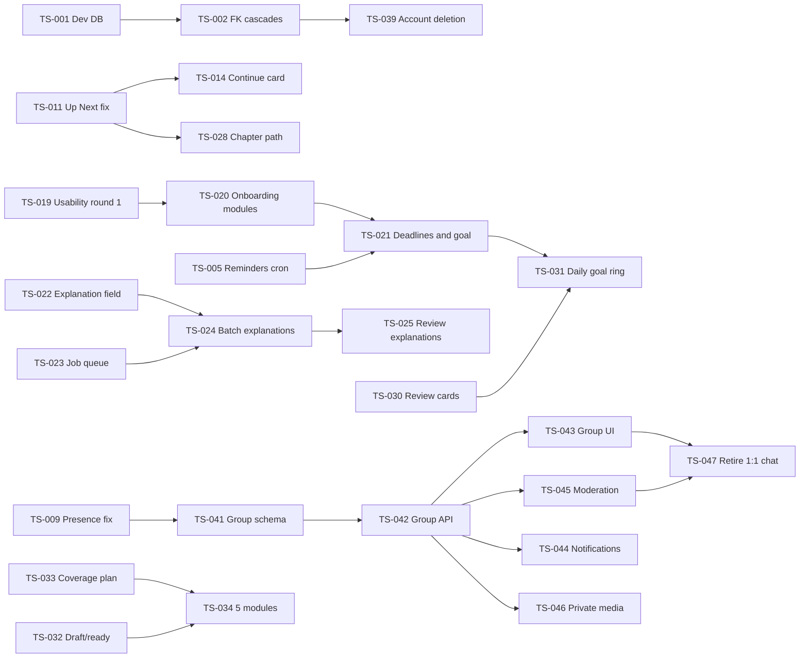

# Tyro Study: Project plan and task breakdown

*Phase 5 of the project lifecycle. Written 29 October 2026. Turns the requirements (`02-requirements.md`), design (`03-ux-ui-design.pdf`) and architecture (`04-technical-architecture.md`) into a prioritised backlog, estimates, sprints, owners and a Definition of Done.*

> **The backlog also lives in `business/tracking/backlog.csv`** (50 items), ready to import into Jira, Azure DevOps or GitHub Projects (section 7). This document and the CSV are generated from the same list, so they match.

---

## 1. How the plan works

| Choice | Decision | Why |
|---|---|---|
| Method | **Lightweight Scrum**: 2-week sprints, a short plan at the start, a review and retro at the end | Fixed rhythm for a part-time solo developer; easy to show progress |
| Estimates | **Story points** (1, 2, 3, 5, 8), with **1 point ≈ 2 focused hours** | Relative sizing is quicker than hours; the hours give a sanity check |
| Capacity | **About 10 development points per sprint** (≈ 10 hours a week alongside a full-time job and studies). The holiday sprint S4 is 3 weeks and planned at 15. | Honest capacity keeps the plan believable. Adjust after 2 sprints using the real velocity. |
| Priority | **P1** must do now (safety, broken core path) · **P2** should do this semester · **P3** could · **P4** later / decide with data | Maps to MoSCoW in the requirements |
| Order | Safety and visibility first, then the UX review's quick wins, then activation (before Semester 1 2027 starts), then retention, then module groups | Matches the discovery decision criteria due at the end of January 2027 |
| Buffer | S11 and S12 are light on purpose | Absorbs slips before the May–June exam season, when students need the app most |

**Totals:** 50 items, **151 points** (≈ 300 hours). 138 points are scheduled across 12 sprints (2 Nov 2026 – 30 Apr 2027); 13 points are parked for later.

---

## 2. Milestones

| Milestone | Ends | Outcome | Exit criteria (how we know it's done) |
|---|---|---|---|
| **M0 Stabilise** | Fri 27 Nov 2026 | Live data is safe; errors and outages are visible; reminders work | Local dev off production DB; Sentry and uptime alerts live; FK cascades, headers, zoom, sign-in rate limit shipped; presence no longer capped at 100 |
| **M1 Quick UX wins** | Fri 11 Dec 2026 | The main study path no longer breaks | Up Next never locked; quiz focus mode; Continue card; pass/fail screens; Logout in Me; usability round 1 done |
| **M2 Activation** | Fri 5 Feb 2027 | New students get a first win in one sitting, ready for Semester 1 2027 | Onboarding live; explanations on 95% of active-module questions; streak counts study; 5 complete modules on track; **activation ≥ 25%** on `/admin/analytics` |
| **M3 Retention** | Fri 5 Mar 2027 | Reasons to come back daily | Chapter path, review cards, backups, self-service deletion; **Day-7 return ≥ 15%** |
| **M4 Module groups** | Fri 16 Apr 2027 | One moderated group per module; 1:1 chat retired | All group chat items done; moderation tested with a high school group |
| **M5 Polish** | Fri 30 Apr 2027 | Desktop layout; buffer before exams | Desktop Home live; no P1/P2 bugs open |

The **M2 targets** are the go/no-go numbers from the discovery document (section 5): if activation stays low after M2, stop building features and interview students first.

---

## 3. Sprint plan

| Sprint | Dates | Milestone | Goal | Items | Dev pts |
|---|---|---|---|---|---|
| S1 | Mon 2 Nov – Fri 13 Nov 2026 | M0 Stabilise | Safety and visibility first | TS-001, TS-002, TS-003, TS-004, TS-005, TS-006, TS-007 | 10 |
| S2 | Mon 16 Nov – Fri 27 Nov 2026 | M0 Stabilise | Close security gaps; first UX fixes | TS-008, TS-009, TS-011, TS-012 | 10 |
| S3 | Mon 30 Nov – Fri 11 Dec 2026 | M1 Quick UX wins | Ship the UX review quick wins; test the prototype | TS-010, TS-013, TS-014, TS-015, TS-017, TS-019 | 10 |
| S4 | Mon 14 Dec 2026 – Fri 8 Jan 2027 | M2 Activation | Onboarding, explanations, Sheet, tests (3 weeks over the holidays) | TS-016, TS-018, TS-020, TS-021, TS-022, TS-033 | 15 |
| S5 | Mon 11 Jan – Fri 22 Jan 2027 | M2 Activation | Job queue, study streak, draft/ready content | TS-023, TS-027, TS-032, TS-034 | 9 |
| S6 | Mon 25 Jan – Fri 5 Feb 2027 | M2 Activation | Explanations everywhere, reports, lesson steps, fast notes | TS-024, TS-026, TS-029, TS-034, TS-036 | 11 |
| S7 | Mon 8 Feb – Fri 19 Feb 2027 | M3 Retention | Learning path, faster quiz queries, backups | TS-025, TS-028, TS-034, TS-035, TS-037 | 10 |
| S8 | Mon 22 Feb – Fri 5 Mar 2027 | M3 Retention | Review cards, account deletion, admin security | TS-030, TS-034, TS-039, TS-040 | 11 |
| S9 | Mon 8 Mar – Fri 19 Mar 2027 | M4 Module groups | Daily goal; group chat schema and API; round-2 testing | TS-031, TS-038, TS-041, TS-042 | 11 |
| S10 | Mon 22 Mar – Fri 2 Apr 2027 | M4 Module groups | Group UI, notifications, private media | TS-043, TS-044, TS-046 | 10 |
| S11 | Mon 5 Apr – Fri 16 Apr 2027 | M4 Module groups | Moderation and retire 1:1 chat | TS-045, TS-047 | 7 |
| S12 | Mon 19 Apr – Fri 30 Apr 2027 | M5 Polish | Desktop layout; buffer before May–June exams | TS-048 | 5 |
| Later | – | – | Decide after round-2 testing | TS-049, TS-050 | – |

*Dev pts* counts development work only; research (TS-019, TS-038) and content (TS-025, TS-033, TS-034) use separate time. TS-034 (5 complete modules) runs across S5–S8.

**Within a sprint, do dependent items in order:** TS-001 before TS-002; TS-020 before TS-021; TS-041 before TS-042; TS-045 before TS-047.

---

## 4. Dependencies and critical path



**Critical path to Semester 1 (M2):** TS-019 → TS-020 → TS-021 (onboarding) and TS-022 → TS-023 → TS-024 → TS-025 (explanations). If either chain slips past S6, Semester 1 starts without it, so protect these items first when a sprint is short.

---

## 5. Prioritised backlog

Columns: **Pri** priority, **Pts** story points (≈ 2 h each). Requirement ids (FR, NFR, BR), risks (R) and gaps refer to the earlier documents and are in the CSV.

### E1 · Stabilise and protect

| ID | Item | Type | Pri | Pts | Depends on | Sprint | Owner | Done when |
|---|---|---|---|---|---|---|---|---|
| TS-001 | Use a local Docker DB / Neon dev branch for development | Chore | P1 | 1 | – | S1 | Taelo (Dev) | `.env.local` points at local or dev DB; production URL only in Vercel; README updated |
| TS-002 | Add FK cascades to PushSubscription and Assignment_Attempt | Tech | P1 | 2 | TS-001 | S1 | Taelo (Dev) | Orphans cleaned; migration applied with migrate deploy; deleting a test user removes their rows |
| TS-003 | Allow pinch-zoom (remove maximumScale/userScalable) | Bug | P1 | 1 | – | S1 | Taelo (Dev) | Zoom works on iOS and Android; no layout break at 200% |
| TS-004 | Security headers (HSTS, CSP, nosniff, referrer, frame-ancestors) | Tech | P1 | 2 | – | S1 | Taelo (Dev) | Headers present on all routes; AdSense, Pusher, Blob still work; securityheaders.com grade A |
| TS-005 | Confirm and schedule reminders cron (vercel.json + CRON_SECRET) | Bug | P1 | 1 | – | S1 | Taelo (Dev) | A reminder set 5 min ahead arrives on a test phone in production |
| TS-008 | Rate-limit sign-in attempts | Tech | P1 | 3 | – | S2 | Taelo (Dev) | 6th failed attempt within 15 min is refused with a generic message; resets after window |
| TS-009 | Replace global Pusher presence with lastSeen heartbeats | Tech | P1 | 2 | – | S2 | Taelo (Dev) | Online dots and counts work with >100 users (load script); presence-online channel removed |

### E2 · Operations and quality

| ID | Item | Type | Pri | Pts | Depends on | Sprint | Owner | Done when |
|---|---|---|---|---|---|---|---|---|
| TS-006 | Sentry error tracking (server + client, source maps) | Tech | P1 | 2 | – | S1 | Taelo (Dev) | A test error appears in Sentry with release and route; no personal data in events |
| TS-007 | /api/health endpoint + uptime monitor with alerts | Tech | P1 | 1 | – | S1 | Taelo (Dev) | Monitor pings every minute; alert received when DB URL is wrong in preview |
| TS-010 | CI pipeline: validate, typecheck, lint, build on every push | Tech | P1 | 2 | – | S3 | Taelo (Dev) | GitHub Action runs on PRs; merge blocked on failure |
| TS-018 | Unit tests for core rules (locks, scoring, streak, mock plan, analytics SQL) | Tech | P2 | 3 | TS-010 | S4 | Taelo (Dev) | Tests run in CI; cover the business rules BR-20 to BR-26 |
| TS-037 | Weekly off-provider pg_dump backup + restore test | Tech | P2 | 2 | – | S7 | Taelo (Dev) | Encrypted dump stored weekly; restored locally once |
| TS-038 | Usability test round 2 on built app (5 new participants) | Research | P2 | 3 | TS-020, TS-022, TS-015 | S9 | Taelo (Product) | SUS ≥ 75; activation trend reviewed in /admin/analytics |

### E3 · Quick UX wins

| ID | Item | Type | Pri | Pts | Depends on | Sprint | Owner | Done when |
|---|---|---|---|---|---|---|---|---|
| TS-011 | Fix 'Up next' to the first unlocked, unpassed topic | Bug | P1 | 2 | – | S2 | Taelo (Dev) | Unit test 'up next is never locked' passes; dashboard never links to a lock screen |
| TS-012 | Quiz focus mode: hide bottom nav, sticky Check answer, move scrap pad | Story | P1 | 3 | – | S2 | Taelo (Dev) | On 360-px phone, Check answer always visible; nav hidden on /quiz and /mock-exam |
| TS-013 | Move Logout into a Me tab; new 5-item bottom nav | Story | P2 | 2 | – | S3 | Taelo (Dev) | Nav: Home, Study, Plan, Chats, Me; Sign out only in Me |
| TS-014 | Continue card at the top of Home | Story | P1 | 2 | TS-011 | S3 | Taelo (Dev) | Matches 01-dashboard design; one tap opens the next lesson |
| TS-015 | Separate pass and fail result screens with one main action | Story | P2 | 3 | – | S3 | Taelo (Dev) | Pass shows unlocked topic; fail shows 'So close' and topics to revise (designs 07, 15) |
| TS-016 | Replace alert()/confirm() with toasts and a Sheet component | Tech | P2 | 3 | – | S4 | Taelo (Dev) | No alert/confirm left in student pages; Sheet traps focus, closes on Esc |
| TS-017 | Contrast fixes (muted on grey, locked text, orange chips, field borders) | Bug | P2 | 1 | – | S3 | Taelo (Dev) | All pairs in the contrast table pass AA |

### E4 · Activation

| ID | Item | Type | Pri | Pts | Depends on | Sprint | Owner | Done when |
|---|---|---|---|---|---|---|---|---|
| TS-019 | Usability test round 1 with the prototype (8 participants) | Research | P1 | 3 | – | S3 | Taelo (Product) | 8 sessions done; findings table with severity; design updated |
| TS-020 | Onboarding step: pick modules (multi-select + search) | Story | P1 | 3 | TS-019 | S4 | Taelo (Dev) | New user lands in onboarding; can join several modules in one step |
| TS-021 | Onboarding step: deadlines, daily goal, reminder time | Story | P1 | 3 | TS-020, TS-005 | S4 | Taelo (Dev) | Values saved (onboardedAt, dailyGoalMinutes, reminderTime); ends in first lesson |

### E5 · Learning and retention

| ID | Item | Type | Pri | Pts | Depends on | Sprint | Owner | Done when |
|---|---|---|---|---|---|---|---|---|
| TS-027 | Streak counts study (lesson finished or quiz passed) | Story | P1 | 2 | – | S5 | Taelo (Dev) | Opening the app no longer adds a day; passing a quiz does |
| TS-028 | Chapter path view with per-topic status | Story | P2 | 5 | TS-011 | S7 | Taelo (Dev) | Passed ✓ with score, one current node, lock reasons, chapter quiz at the end |
| TS-029 | Lesson steps Read → Cards → Quiz + sticky bottom bar | Story | P2 | 3 | – | S6 | Taelo (Dev) | Reading progress, time, outcomes; 'I'm done reading' goes to cards or quiz |
| TS-030 | Spaced-repetition review cards (card_reviews + /review) | Story | P2 | 5 | – | S8 | Taelo (Dev) | Due cards shown daily; ratings schedule next review; counts to daily goal |
| TS-031 | Daily goal ring on Home | Story | P3 | 3 | TS-021, TS-030 | S9 | Taelo (Dev) | Ring reflects Read/Cards/Quiz done today against chosen minutes |
| TS-049 | XP, milestones and shareable cards | Story | P4 | 5 | TS-027 | Later | Taelo (Dev) | Optional; decided after round-2 testing |

### E6 · Content quality

| ID | Item | Type | Pri | Pts | Depends on | Sprint | Owner | Done when |
|---|---|---|---|---|---|---|---|---|
| TS-022 | questions.explanation column + show after each answer | Story | P1 | 3 | – | S4 | Taelo (Dev) | Feedback sheet shows explanation when present; falls back to correct answer only |
| TS-024 | Batch-generate explanations for existing questions | Story | P1 | 3 | TS-022, TS-023 | S6 | Taelo (Dev) | 95% of questions in active modules have an explanation; spot-check 30 |
| TS-025 | Review explanations in active modules | Content | P1 | 3 | TS-024 | S7 | Content admin | Each active module reviewed; wrong ones fixed |
| TS-026 | Report a question/lesson problem + admin queue | Story | P2 | 3 | – | S6 | Taelo (Dev) | Student can report from feedback sheet; admin sees and resolves |
| TS-032 | topics.status draft/ready; students see ready only | Story | P2 | 2 | – | S5 | Taelo (Dev) | Draft topics hidden from students in app; admins see both |
| TS-033 | Content coverage plan for Semester 1 2027 modules | Content | P1 | 2 | – | S4 | Taelo (Product) | List of modules users joined/asked for; owner and date per module |
| TS-034 | Build and review content for 5 complete modules | Content | P1 | 8 | TS-033, TS-032 | S5-S8 | Content admin | 5 modules: every topic has lesson + quiz, reviewed |

### E7 · Module group chats

| ID | Item | Type | Pri | Pts | Depends on | Sprint | Owner | Done when |
|---|---|---|---|---|---|---|---|---|
| TS-041 | Group chat schema + migration (chat_groups, group_messages, state) | Tech | P2 | 3 | TS-009 | S9 | Taelo (Dev) | One group per module created; backfilled for existing modules |
| TS-042 | Group chat API + private channels + rate limit | Story | P2 | 5 | TS-041 | S9 | Taelo (Dev) | Members-only read/post; 11th message in a minute refused |
| TS-043 | Group list and thread UI (designs 10, 11) | Story | P2 | 5 | TS-042 | S10 | Taelo (Dev) | Unread counts, replies, mentions, paging of 50 |
| TS-044 | Notifications per group (mentions default, all, mute) | Story | P2 | 3 | TS-042 | S10 | Taelo (Dev) | Mention sends push; muted group sends none |
| TS-045 | Report, block, admin moderation (delete, mute, pin) | Story | P1 | 5 | TS-042 | S11 | Taelo (Dev) | Report reaches admin queue; deleted shows 'removed by a moderator' |
| TS-046 | Private chat media via signed URLs | Tech | P2 | 2 | TS-042 | S10 | Taelo (Dev) | Chat files not readable without a valid session link |
| TS-047 | Retire friend requests and 1:1 chat | Chore | P2 | 2 | TS-043, TS-045 | S11 | Taelo (Dev) | Old routes off; old messages handled per decision (open question) |

### E8 · Platform and scale

| ID | Item | Type | Pri | Pts | Depends on | Sprint | Owner | Done when |
|---|---|---|---|---|---|---|---|---|
| TS-023 | Background job queue for AI work | Tech | P2 | 5 | – | S5 | Taelo (Dev) | Jobs retried and idempotent; admin sees progress; no request over 60 s |
| TS-035 | quiz_attempts.kind/chapterId columns, JSONB, indexes | Tech | P2 | 3 | TS-018 | S7 | Taelo (Dev) | No LIKE on settings; progress queries use indexes |
| TS-036 | ISR for public notes; revalidate on publish | Tech | P2 | 2 | – | S6 | Taelo (Dev) | Notes pages cached; publish shows change within a minute |
| TS-048 | Desktop layout: sidebar + side panel (design 16) | Story | P3 | 5 | TS-013 | S12 | Taelo (Dev) | ≥1024 px shows sidebar layout; phones unchanged |

### E9 · Compliance and accounts

| ID | Item | Type | Pri | Pts | Depends on | Sprint | Owner | Done when |
|---|---|---|---|---|---|---|---|---|
| TS-039 | Self-service account deletion (DELETE /profile) | Story | P2 | 3 | TS-002 | S8 | Taelo (Dev) | Password-confirmed delete removes data and uploaded blobs |
| TS-040 | Admin sign-in OTP and session revocation (tokenVersion) | Tech | P3 | 3 | – | S8 | Taelo (Dev) | Admins confirm a code; password change signs out other devices |
| TS-050 | Paid tier decision and payment integration | Epic | P4 | 8 | TS-038 | Later | Taelo (Product) | Decision made from willingness-to-pay data |

---

## 6. Ownership, Definition of Ready and Definition of Done

### 6.1 Roles and ownership

Tyro has one person today, so roles are hats, not people. Writing them down makes it easy to hand a role to a helper later.

| Role | Who now | Owns | Accountable for |
|---|---|---|---|
| **Product owner** | Taelo | Backlog order, priorities, acceptance, usability tests, analytics review | Building the right thing |
| **Developer** | Taelo | Design-to-code, tests, migrations, deploys | Building it right |
| **Content admin** | Taelo (later: tutors or student helpers) | Module coverage, AI content review, explanations, moderation queue | Content accuracy |
| **Testers** | 6–8 UNISA students and 2 Grade 12 learners | Usability sessions | Honest feedback |
| **Moderator** (from M4) | Admins | Group chat reports | Safe groups |

| Work type | Responsible | Accountable | Consulted | Informed |
|---|---|---|---|---|
| Story / bug / tech item | Developer | Product owner | Testers (UX items) | Students via release notes |
| Content item | Content admin | Product owner | Developer (tools) | – |
| Research item | Product owner | Product owner | Testers | – |
| Production incident | Developer | Product owner | – | Students (banner if long) |

### 6.2 Definition of Ready (before an item enters a sprint)

- [ ] Clear title and **acceptance criteria** (the "Done when" column)
- [ ] Linked to a requirement, design screen or risk
- [ ] Estimated in points; anything above 5 split into smaller items
- [ ] Dependencies done or scheduled earlier in the same sprint
- [ ] Design available for UI items (`business/design/screens`)
- [ ] Data changes described (migration, new events to track)

### 6.3 Definition of Done (every item)

**Code and quality**
- [ ] Acceptance criteria met and checked by the product owner
- [ ] `prisma validate`, `tsc --noEmit`, `eslint` and `next build` pass (CI green once TS-010 lands)
- [ ] Tests added or updated for business rules and permissions (unit; end-to-end for core flows)
- [ ] No secrets, personal data or `console.log` noise added; errors logged without personal data

**Data and safety**
- [ ] Migrations are additive or safely reversible, tested on a Neon branch, and code tolerates the migration not having run yet (`orFallback`)
- [ ] Authorisation checked on the server for every new route (student, admin, superuser)
- [ ] New user data covered by deletion (cascade) and the Privacy Policy if it's a new kind of data

**User experience**
- [ ] Matches the design (or the change is agreed and the design updated)
- [ ] Works on a 360-px phone and on desktop; no horizontal scroll
- [ ] Accessibility: keyboard reachable, visible focus, contrast AA, not colour alone, zoom works
- [ ] Plain-English copy in South African spelling; "module/subject" wording follows the student's level
- [ ] Analytics event added if the item changes a funnel step (`src/lib/analytics-shared.ts`)

**Release**
- [ ] Deployed to a Vercel preview and checked on a real phone
- [ ] Deployed to production; migration applied with `prisma migrate deploy`
- [ ] Item closed in the tracker; requirement status updated in `02-requirements.md` if it changes; release note line written

**Sprint done:** sprint goal met or the gap explained, velocity recorded, demo recorded (screen capture), retro note written (keep / change / try).

---

## 7. Tracking the work

### 7.1 Recommended tool: GitHub Projects

The code is in Git and a GitHub Project sits next to the issues and pull requests, with no extra cost or login. Jira or Azure DevOps work equally well with the same CSV.

**Setup (one time):**
1. Create a GitHub Project (table layout) named **Tyro Study**.
2. Add fields: **Status** (Backlog, Ready, In progress, In review, Done), **Priority** (P1–P4), **Points** (number), **Epic** (single select E1–E9), **Owner** (text), **Sprint** (iteration, 2 weeks, starting Mon 2 Nov 2026).
3. Create the issues, labels and sprint milestones from the CSV:
   ```bash
   gh auth login
   python business/tracking/create_github_issues.py --repo OWNER/REPO --project 1 --owner OWNER --dry-run
   python business/tracking/create_github_issues.py --repo OWNER/REPO --project 1 --owner OWNER
   ```
   The script is safe to run again: issues that already exist are skipped.
4. Views: **Board** by Status (current sprint), **Table** by Epic (whole backlog), **Roadmap** by Sprint, **My work** filtered to Owner.
5. Automation: new issues → Backlog; linked PR opened → In review; PR merged → Done.
6. Link work: branch names `ts-012-quiz-focus-mode`, PR titles start with the id, PR body says `Closes #<issue>`.

### 7.2 Jira or Azure DevOps instead

| Tool | How to import `backlog.csv` | Map these columns |
|---|---|---|
| **Jira** | Project settings → Import → CSV (System → External system import) | Title → Summary · Type → Issue Type · Priority → Priority · Story Points → Story point estimate · Epic → Epic Link (create epics E1–E9 first) · Sprint → Sprint · Acceptance Criteria → Description · Labels → Labels |
| **Azure DevOps** | Boards → Work items → Import work items (CSV) | Title → Title · Type → Work Item Type (Story → User Story, Task, Bug) · Story Points → Story Points · Priority → Priority (1–4) · Sprint → Iteration Path · Acceptance Criteria → Acceptance Criteria |

### 7.3 Rhythm

| When | What | Time |
|---|---|---|
| Sprint day 1 (Monday) | Plan: pick items up to capacity, confirm sprint goal | 30 min |
| Weekly (Monday) | Check the board, move blockers, glance at `/admin/analytics` | 15 min |
| Sprint last day (Friday) | Review (demo to yourself or a tester, record it) and retro | 45 min |
| Monthly | Cost review (Vercel, Neon, Pusher, OpenAI) and metrics vs goals | 30 min |

### 7.4 Measuring progress

| Measure | Where | Use |
|---|---|---|
| Velocity (points done per sprint) | Project insights / a sprint log | Re-plan after S2: if velocity is 6, push M3–M5 out by the difference |
| Burn-up to each milestone | Project roadmap chart | See early when a milestone date is at risk |
| Escaped bugs (found in production) | Sentry + issues labelled `bug` | Quality of Done |
| Product outcomes | `/admin/analytics` | Activation, Day-1/Day-7 return, weekly active learners, funnel: the reason for the work |

---

## 8. Plan risks

| Risk | Effect | Response |
|---|---|---|
| Capacity lower than 10 points per sprint (work, studies, exams) | Milestones slip | Re-plan after S2 using real velocity; protect the M2 critical path; drop P3/P4 first |
| Exam weeks (Oct–Nov, May–June) | Little time for the app | No big releases during your own exams; S1 is mostly small items |
| Usability round 1 changes onboarding | Rework | Round 1 (TS-019) is scheduled before onboarding is built |
| AI explanation quality | Review takes longer | Review only active modules first (TS-025); report button (TS-026) catches the rest |
| Group chat bigger than estimated | M4 slips | It's behind M2 and M3 on purpose; ship moderation and groups together or not at all |
| Content work competes with coding | Fewer modules | Treat content as its own time; recruit a helper for the content admin role |

---

## 9. Next actions this week

1. Import `backlog.csv` into the tracker (section 7) and set up the board.
2. Plan Sprint 1 (Mon 2 Nov): TS-001 to TS-007, 10 points.
3. Recruit 8 participants for usability round 1 (TS-019, in S3).
4. Answer the open questions in documents 02 and 04 that block items: old 1:1 messages (TS-047), cron caller (TS-005), queue service (TS-023).
