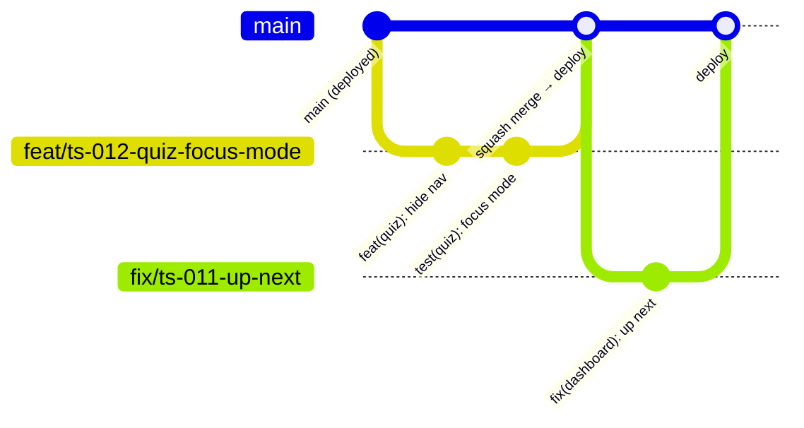

# Tyro Study: Development and version control

*Phase 6 of the project lifecycle. Written 29 October 2026. This phase is mostly about **how** code is written and shipped, so besides this document the setup itself has been added to the repository: a contributor guide, an environment template, a test framework with first tests, a CI workflow, a pull request template and architecture decision records.*

---

## 1. What was set up in the repo

| File | Purpose |
|---|---|
| `CONTRIBUTING.md` | The day-to-day rules: workflow, coding standards, commits, secrets, tests, ADRs |
| `README.md` | Replaces the create-next-app boilerplate: what Tyro is, how to run it locally, scripts, layout, deploy |
| `.env.example` | Every environment variable with comments, no values. `.gitignore` now lets this one file through (`!.env.example`). |
| `.editorconfig` | 2-space indents, UTF-8, final newline, for every editor |
| `vitest.config.ts` + `package.json` scripts | `npm test`, `npm run test:watch`, `npm run typecheck`. Dev dependencies added: `vitest`, `@electric-sql/pglite` (the lockfile only gains packages; no existing version changed). |
| `src/lib/*.test.ts` (5 files) | Unit tests for answer matching, study levels, analytics input cleaning, the mock exam plan and reminder wording |
| `test/integration/analytics-report.test.ts` | Runs the real analytics SQL and real migration against an in-memory PostgreSQL |
| `.github/workflows/ci.yml` | On every pull request and push to `main`: `npm ci`, `prisma validate`, type check, tests, lint (non-blocking for now), build |
| `.github/pull_request_template.md` | Summary, how to check, and the Definition of Done checklist |
| `docs/adr/` (9 records) | Why the code is the way it is (section 7) |
| `scripts/seed-admin.ts` | **Security fix**: credentials moved out of the code (section 5.1) |
| `src/app/api/assignment/grade/route.ts` | `catch (err: any)` → `catch (err)`, the one lint error found in the files checked |

**Checked:** all 28 tests pass (6 files, about 8 seconds). The new files and the changed seed script and route pass the type checker and ESLint. The seed script's guards were tried (missing credentials, short password, remote database: each refused with a clear message).

---

## 2. Branching (GitHub Flow)

The repo (`github.com/Taelo1829/tyro-study`) has only `main`, and every commit so far went straight to it. From now on:



| Rule | Detail |
|---|---|
| `main` is always deployable | Vercel deploys it to www.tyrostudy.co.za |
| One branch per backlog item | `feat/ts-012-quiz-focus-mode`, `fix/ts-011-up-next`, `chore/…`, `refactor/…`, `docs/…`, `test/…` |
| Short-lived | Merge within a sprint; rebase on `main` if it falls behind |
| Pull request for everything | Even working alone: CI runs, Vercel builds a preview, and the PR records why the change was made |
| Squash and merge | One clean commit per item on `main`, titled with the Conventional Commit summary |
| Delete merged branches | GitHub setting "Automatically delete head branches" |

**Protect `main`** (GitHub → Settings → Branches → Add rule for `main`): require a pull request before merging; require the **CI / check** status to pass; block force pushes. As the only developer, allow yourself to bypass in emergencies (hotfix), but don't make it a habit.

**Hotfix:** `fix/hotfix-<what>` from `main`, smallest possible change, PR, merge, deploy. If a deploy breaks production, first use Vercel's instant rollback, then fix forward.

---

## 3. Coding standards

Full list in `CONTRIBUTING.md` §2. They come from what the code already does well, plus the gaps found in the architecture review:

| Area | Standard |
|---|---|
| TypeScript | Strict, no `any`, `@/` imports, validated request bodies, `{ error }` responses with proper status codes |
| Structure | Thin route handlers → `src/lib/<area>` logic; Server Components by default; kebab-case files |
| Database | Migrations only; additive; raw SQL with `orFallback()` for new columns (ADR 0004); scoped to the user; UTC storage, SA-time day maths |
| Security | Server-side authorisation in every route; no secrets or personal data in code, logs or analytics; side effects never undo the main action |
| UI and copy | Design tokens and components from the design document; accessibility AA; plain English, SA spelling, level-aware words; no `alert()`/`confirm()` |
| Style | 2 spaces, double quotes, no semicolons in new files; don't reformat untouched code |

**Formatting:** there's no Prettier config, and the existing files mix styles (some semicolons and single quotes, one 4-space file). Adding a formatter now would rewrite most files. Recommended later: one `chore: format with Prettier` commit on its own, after the open feature branches are merged.

---

## 4. Implementing frontend, backend and database changes

The event tracking added earlier today is the reference for a change that touches all three layers:

| Layer | Files | Pattern to copy |
|---|---|---|
| Database | `prisma/schema.prisma` (model `AnalyticsEvent`), `prisma/migrations/20261029100000_analytics_events/migration.sql` | Model and hand-checked migration in the same commit; foreign key with `ON DELETE CASCADE` so the user's data goes with them |
| Domain logic | `src/lib/analytics.ts`, `analytics-shared.ts`, `analytics-report.ts` | Pure helpers shared by client and server; server code never throws for side effects; SQL with tagged templates |
| API | `src/app/api/events/route.ts`, `track()` calls in existing routes | Allowlist of inputs, user from the session (never the body), work after the response with `after()` |
| Frontend | `src/components/analytics/page-view-tracker.tsx`, `src/app/(dashboard)/admin/analytics/page.tsx` | Client component only where browser APIs are needed; admin page as a Server Component; responsive tables |
| Tests | `src/lib/analytics-shared.test.ts`, `test/integration/analytics-report.test.ts` | Unit tests for cleaning rules; integration test runs the real SQL and migration |
| Docs | `docs/adr/0006-first-party-analytics.md`, Privacy Policy update | Decision recorded; users told |

**Order for each backlog item:** migration and schema → `lib` logic with tests → route handler → UI → analytics event → docs/ADR → PR.

---

## 5. Environment variables and secret management

| Where | What goes there |
|---|---|
| `.env.example` (committed) | Names and comments only. Local Docker database URLs as defaults. |
| `.env.local` (git-ignored) | Your real local values. Local database, test keys. |
| Vercel → Environment Variables | Production and Preview values, set separately. Preview should use test keys and a Neon branch, not production. |
| Password manager | A copy of every production secret, so they can be restored or rotated |
| GitHub → Actions secrets | Only what CI needs. Today CI needs **none**: it uses placeholders and never connects to a service. |

### 5.1 Findings (act on these)

1. **Admin credentials were committed.** `scripts/seed-admin.ts` contained an admin email and password in plain text, so they are in the Git history. The script now reads `SEED_ADMIN_EMAIL` / `SEED_ADMIN_PASSWORD` from the environment, requires 12+ characters, and refuses non-local databases unless `SEED_ALLOW_REMOTE=1`. **If an account with those credentials exists on the live site, change its password now.** If the GitHub repo is (or ever was) public, treat the password as leaked. Removing it from history isn't needed once it's rotated.
2. **`.env.local` points at the production database** (risk R1). Switch it to the Docker database (`npm run db:up`) or a Neon dev branch. Backlog TS-001.
3. **`CRON_SECRET` isn't in `.env.local`**, and nothing in the repo schedules the reminders job. Backlog TS-005.
4. **Turn on GitHub secret scanning and push protection** (Settings → Code security). It blocks pushes that contain API keys.
5. **Rotation playbook:** rotate at the provider → update Vercel (Production and Preview) → redeploy → update the password manager. Rotating `NEXTAUTH_SECRET` signs everyone out.

---

## 6. Tests

| Kind | Where | Runs against | Count today |
|---|---|---|---|
| Unit | `src/lib/*.test.ts` | Pure functions | 22 tests in 5 files |
| Integration | `test/integration/*.test.ts` | Real SQL and migrations on in-memory PostgreSQL (PGlite) | 6 tests |
| End-to-end | later: `e2e/` with Playwright | A preview deployment | – |

```bash
npm test            # everything, ~8 s
npm run test:watch  # re-runs on save
```

**What the first tests protect:** answer matching for code blanks (spacing, quotes, empty answers); study level words and grade parsing; analytics input cleaning (allowlist, query strings stripped, props limited); the mock exam plan (shares, 10-minute minimum, 3-hour cap); reminder wording; and the full analytics report: activation, Day-1/Day-7 return, funnel, admin exclusion, date ranges, and the event writer never throwing.

**Next tests (backlog TS-018):**
- Topic locks and "up next" with PGlite (the TS-011 bug needs a test that fails first).
- Quiz attempt rules: server-side marking, typed answers never returned, time limit grace, resume.
- Streak day boundaries around midnight in South African time.
- Permission tests for admin routes (student gets 403).
- One Playwright journey: sign up → join a module → pass a quiz.

**Rule:** every bug fix starts with a test that reproduces it.

---

## 7. Commit messages

The history already mostly follows Conventional Commits (`feat:`, `feat(graphs):`, `feat(reminders):`). A few don't (`worked on content creation`, `opened locked notes`). The standard (`CONTRIBUTING.md` §3):

```
fix(quiz): keep Check answer above the bottom nav on phones

The submit button sat under the fixed mobile nav, next to Logout.
Hide the nav on quiz routes and pin the button to the bottom.

Refs: TS-012
```

- **Type** says what kind of change (`feat`, `fix`, `refactor`, `perf`, `test`, `docs`, `chore`, `ci`, `build`).
- **Scope** is the area (`quiz`, `auth`, `analytics`, `chat`, `admin`, `db`, `ui`).
- **Summary** is imperative and specific, 72 characters at most.
- **Body** explains why. **Footer** links the backlog item.

---

## 8. Documenting decisions (ADRs)

`docs/adr/` now holds the decisions behind the code, each with context, decision and consequences:

| # | Decision |
|---|---|
| 0001 | Record architecture decisions |
| 0002 | One Next.js app (modular monolith) on Vercel |
| 0003 | PostgreSQL on Neon through Prisma (pooled for the app, direct for migrations) |
| 0004 | Raw SQL with fallbacks for newly added columns |
| 0005 | JWT sessions with email-verified sign-up |
| 0006 | First-party product analytics in Postgres |
| 0007 | Module group chats replace one-to-one chat |
| 0008 | AI providers only behind `src/lib/ai` |
| 0009 | Vitest for tests, PGlite for database tests |

Add a new ADR whenever a choice is hard to reverse or someone would ask "why?". Never edit an accepted ADR's decision: write a new one that supersedes it.

---

## 9. Committing today's work

Everything from today is uncommitted in your working folder on `main`. Commit it as three pull requests, in this order (uncommitted changes carry across `git switch`):

**1. Analytics (code from phase 1)**
```bash
git switch -c feat/analytics-events
git add prisma/schema.prisma prisma/migrations/20261029100000_analytics_events src/prisma \
  src/lib/analytics.ts src/lib/analytics-client.ts src/lib/analytics-shared.ts src/lib/analytics-report.ts \
  src/app/api/events src/components/analytics "src/app/(dashboard)/admin/analytics" "src/app/(dashboard)/admin/page.tsx" \
  src/app/layout.tsx src/app/privacy/page.tsx src/lib/auth.ts \
  src/app/api/auth/register src/app/api/enrollments src/app/api/quiz/attempt src/app/api/push/subscribe \
  src/app/api/chat/messages src/app/api/chat/friends src/app/api/assignment/grade \
  src/app/api/projects src/app/api/exercises "src/app/(dashboard)/modules/[id]/topics/[topicId]/page.tsx"
git commit -m "feat(analytics): record product events and add admin analytics page" \
  -m "First-party events table, server track() and browser trackEvent(), /admin/analytics with activation, Day-1/Day-7 return and the sign-up funnel. Privacy Policy updated." \
  -m "Refs: FR-92, FR-93"
git push -u origin feat/analytics-events
```
Open the PR, check the preview, merge. Then apply the migration to production (`npx prisma migrate deploy` with the direct URL).

**2. Development setup (this phase)**
```bash
git switch main && git pull
git switch -c chore/dev-setup-tests-ci
git add package.json package-lock.json vitest.config.ts src/lib/*.test.ts test .github \
  .env.example .gitignore .editorconfig docs/adr CONTRIBUTING.md README.md scripts/seed-admin.ts
git commit -m "chore: add tests, CI, env template, contributing guide and ADRs" \
  -m "Vitest unit tests and PGlite integration tests, GitHub Actions CI, .env.example, PR template, ADRs 0001-0009. Seed script reads admin credentials from the environment instead of the code." \
  -m "Refs: TS-010, TS-018"
git push -u origin chore/dev-setup-tests-ci
npm install   # installs vitest and pglite locally
npm test
```

**3. Lifecycle documents**
```bash
git switch main && git pull
git switch -c docs/business-lifecycle
git add business
git commit -m "docs: add discovery, requirements, design, architecture, plan and dev docs"
git push -u origin docs/business-lifecycle
```

(The `src/app/api/assignment/grade/route.ts` lint fix goes in with PR 1 because that file also gained a `track()` call.)

---

## 10. Open points

1. **Lint:** CI runs `npm run lint` but doesn't block on it yet, because the whole repo hasn't been linted here. Run `npm run lint` locally, fix what it finds, then remove `continue-on-error` from `.github/workflows/ci.yml`.
2. **Line endings:** the working files use Windows line endings (CRLF). That's fine with Git's default Windows setting. If diffs ever show every line changed, add a `.gitattributes` with `* text=auto` in a separate commit.
3. **Branch protection and secret scanning** need turning on in GitHub settings (sections 2 and 5).
