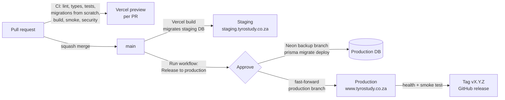

# Tyro Study: CI/CD and deployment preparation

*Phase 9 of the project lifecycle. Written 29 October 2026. Builds on the CI workflow from phase 6, the tests from phases 7–8 and the architecture in phase 4. The pipeline described here is implemented in the repo; the one-time setup in Vercel, Neon and GitHub (section 8) is yours to do, because it needs your accounts.*

---

## 1. Summary

**Before:** every merge to `main` went straight to production. Migrations were run by hand from a laptop, and nothing guaranteed they ran before (or after) the code that needed them. There was no staging, no restore point before a migration, no record of what was released when, and nothing called `/api/cron/reminders` on a schedule from the repo.

**After:**

| Area | What's in place | Where |
|---|---|---|
| Build and test on every change | One CI job: Prisma validate, migration safety check, lint, types, 44 tests, **all 22 migrations applied to an empty Postgres and re-run**, schema drift report, production build, test fixtures, smoke test, **46 security checks** | `.github/workflows/ci.yml` |
| Environments | Development (local), test (CI + per-PR previews), staging (`main`), production (`production` branch) | §3 |
| Safe migrations | Expand/contract rule enforced in CI; staging migrated by its build; production migrated by a gated workflow after a Neon backup and **before** the code switches | §5, `scripts/ci/check-migrations.mjs`, `docs/runbooks/migrations.md` |
| Configuration per environment | Variable matrix, build-time check that fails on missing or unsafe values (names only, never values) | §6, `scripts/ci/check-env.mjs` |
| Release notes | `CHANGELOG.md` + template; the release workflow refuses to run without notes and publishes them as the GitHub release | §7 |
| Rollback | Vercel Instant Rollback for code, Neon backup branch / restore for data, written runbook | §7.3, `docs/runbooks/rollback.md` |
| Health and smoke | `GET /api/health` (commit, environment, latest migration); read-only smoke test used by CI and after each release | `src/app/api/health/route.ts`, `scripts/ci/smoke.mjs` |

Decision recorded as **ADR 0010**.

---

## 2. What was tested here

The pipeline pieces were run in the container, the same way CI will run them:

| Check | Result |
|---|---|
| `actionlint` on all workflows (ci, release, codeql) | No errors |
| All 22 migrations on an empty PostgreSQL 16, in order | All applied |
| `check-migrations.mjs --all` on existing migrations | No risky statements |
| `check-migrations.mjs` on a test branch that edits an applied migration, adds an out-of-order one, drops a column and indexes `users` without `CONCURRENTLY` | **All four caught**, exit 1 |
| Same, with an additive migration (nullable column, `NOT NULL DEFAULT 0`) | Passes |
| `check-env.mjs`: missing variables; production with localhost database, placeholder secret and http URLs; valid preview | Fails / fails with 4 errors / passes with warnings |
| `vercel-build.mjs` (env check → skip migrations → build) | Build passes |
| `/api/health` | `{"ok":true,"commit":"…","env":"production","migration":"20261029100000_analytics_events"}` |
| `smoke.mjs` against the build | 9/9 pass |
| `security-tests.mjs` with the new known-issues list | 46 pass, 0 new failures, 4 known (exit 0) |
| `release-notes.mjs 1.0.0` with only "Unreleased" in the changelog | Refuses (exit 1); after renaming the section, prints the notes |
| Type check, lint, 44 unit/integration tests | Pass |

**Not testable here:** the Prisma CLI itself (its engine download is blocked in this container; GitHub runners download it normally), the Neon API, Vercel deployments and the GitHub environment approval. The first run of each happens during setup (section 8), on staging first.

---

## 3. Environments

| | Development | Test | Staging | Production |
|---|---|---|---|---|
| **Purpose** | Write code | Prove a change | Check the merged result like a student would; UAT | Students |
| **Where** | Your PC, `localhost:4000` | GitHub Actions (CI) and a Vercel preview per PR | Vercel preview of `main` at **staging.tyrostudy.co.za** | Vercel production at **www.tyrostudy.co.za** |
| **Deploys when** | `npm run dev` | Every push to a PR | Every merge to `main` | **Release to production** workflow (manual, approved) |
| **Database** | Docker Postgres (`npm run db:up`) | CI: throwaway Postgres 16. PR previews: the staging database, read-mostly | Neon branch **`staging`**: schema from migrations, **test data only** | Neon production branch |
| **Migrations** | `prisma migrate dev` (local only) | CI applies all from scratch | During the Vercel build (`MIGRATE_ON_BUILD=1`, scoped to `main`) | Release workflow, after approval and a backup branch |
| **Real student data** | Never | Never | **Never** (POPIA: no copies of personal data outside production) | Yes |
| **Email, push, AI** | Optional own test keys | Placeholders | Test keys; email only to test addresses | Live keys |
| **Access** | You | GitHub / preview links behind Vercel login | Vercel Deployment Protection (Vercel login) | Public |

**Why the PR previews share the staging database and don't migrate:** a PR's migration isn't merged yet, so it mustn't change staging. CI already proves every migration on a fresh Postgres. A PR whose code needs a new column still loads on its preview because new columns use raw SQL with fallbacks (ADR 0004). When a PR needs its own database (a big schema change), create a Neon branch from `staging` by hand and set it as that preview's `DATABASE_URL`.

**Why staging uses its own Neon branch with test data:** Neon's Vercel integration can create a branch per preview, but those branches copy production, i.e. real students' names, emails and chats, into every preview. That conflicts with POPIA's purpose limitation and security conditions (business/08 §6). The `staging` branch is created **schema-only** and filled with the QA fixtures.

---

## 4. Build and test automatically

### 4.1 CI (`.github/workflows/ci.yml`)

Runs on every pull request and every push to `main`. One job, cheapest checks first, ~8–10 minutes:

| Step | Fails the build when |
|---|---|
| `npm ci` | Lockfile out of sync |
| `prisma validate` | Schema invalid |
| Migration safety (PRs) | An applied migration was edited/deleted, a new one is out of order, or a destructive/locking statement has no `-- tyro:allow-destructive` note |
| Lint, type check, unit + integration tests | Any error or failing test |
| `prisma migrate deploy` on an empty Postgres, then again, then `migrate status` | A migration fails from scratch, or re-running isn't a no-op |
| Schema drift report | *Informational:* differences between `schema.prisma` and the migrated database (columns added with raw SQL show here until they're in the schema) |
| `npm run build` | Build error |
| Seed fixtures, start the app, wait for `/api/health` | App can't start or reach the database |
| Smoke test | A key page or protected API answers wrongly |
| Security and permission tests | Any **new** failure; the 4 accepted, ticketed ones are in `scripts/qa/known-issues.json` and reported as KNOWN |
| Upload `security-results.json`, `next.log` | – (kept 14 days) |

Plus the **audit** job (informational until the Next.js upgrade) and **CodeQL** weekly and on PRs.

**Branch protection on `main`** (GitHub → Settings → Rules): require a PR, require the `check` status, block force pushes. Solo developer: allow yourself to bypass in an emergency, but the release workflow still requires CI green on the commit.

### 4.2 On Vercel

`vercel.json` sets the build command to `npm run vercel-build` (`scripts/ci/vercel-build.mjs`): check environment variables → migrate (staging only) → `next build`. Dependabot branches don't get previews (they're checked by CI).

---

## 5. Applying database migrations safely

### 5.1 The rule: expand, then contract

The release workflow migrates production **a few minutes before** the new code goes live, and a rollback puts the **old** code back on the **new** schema. So every migration must work with both versions:

- **Expand (any release):** add tables, nullable columns, columns with defaults, indexes (`CONCURRENTLY` on big tables, in their own migration).
- **Contract (a later release, once no deployed code uses the old shape):** drop, rename, `SET NOT NULL`, type changes. These need `-- tyro:allow-destructive <reason>` in the file and a second look.

Full examples (rename a column in three releases, etc.) are in `docs/runbooks/migrations.md`.

### 5.2 Who migrates what

| Database | How | Safeguards |
|---|---|---|
| Local | `prisma migrate dev` | – |
| CI | `prisma migrate deploy` on a fresh database | Proves the full history applies, every run |
| Staging | Vercel build of `main` with `MIGRATE_ON_BUILD=1` | Branch-scoped variable; refused in production by `check-env` and by the script |
| Production | Release workflow, `migrate` job | Reviewer approval (GitHub environment), **Neon backup branch `pre-vX.Y.Z`** first (3 kept), runs before the code is deployed; production build never migrates |

### 5.3 First release: baseline

Production was migrated by hand before this pipeline. Before the first release run `npx prisma migrate status` against production (read-only). If migrations that are already in the database show as "not yet applied", mark them with `prisma migrate resolve --applied <name>` so `migrate deploy` doesn't try to recreate tables. Steps in `docs/runbooks/migrations.md`.

### 5.4 Also changed

`npm run db:setup` now uses `prisma migrate deploy` instead of `db push`, so local databases match production's migration history. A local database created with `db push` needs a reset once: `docker compose down -v && npm run db:setup`.

---

## 6. Environment-specific configuration

### 6.1 Where values live

| Kind | Location |
|---|---|
| App variables per environment | Vercel → Settings → Environment Variables: **Production**, **Preview** (with branch-specific overrides for `main` = staging), **Development** (for `vercel env pull`) |
| Local | `.env.local` (git-ignored), template `.env.example` |
| Pipeline secrets | GitHub → Settings → Environments → **production**: `PRODUCTION_DIRECT_DATABASE_URL`, `NEON_API_KEY`, `NEON_PROJECT_ID`; variable `PRODUCTION_URL` |
| CI | Placeholders in the workflow file only; CI never sees a real secret |

### 6.2 Variable matrix

| Variable | Development | Preview (PRs) | Staging (`main` override) | Production |
|---|---|---|---|---|
| `DATABASE_URL` | Docker | Neon `staging`, pooled | Neon `staging`, pooled | Neon production, pooled |
| `DIRECT_DATABASE_URL` | = `DATABASE_URL` | Neon `staging`, direct | Neon `staging`, direct | Neon production, direct |
| `MIGRATE_ON_BUILD` | – | **unset** | `1` | **never** (build fails) |
| `NEXTAUTH_SECRET` | own | **different from production** | same as Preview | own; ≥32 chars |
| `NEXTAUTH_URL`, `APP_URL` | `http://localhost:4000` | unset (falls back to the preview URL) | `https://staging.tyrostudy.co.za` | `https://www.tyrostudy.co.za` (must be https) |
| `RESEND_API_KEY`, `EMAIL_FROM` | optional | test key | test key | live |
| `PUSHER_*` | optional | separate Pusher app "tyro-staging" | same | live app |
| `VAPID_*` | optional | separate key pair | same | live pair (changing it breaks existing subscriptions) |
| `BLOB_READ_WRITE_TOKEN` | optional | separate Blob store | same | live store |
| `OPENAI_API_KEY` | optional | key with a low monthly limit | same | live with spend limit |
| `CRON_SECRET` | any | own | own | own |

**Separate keys** stop a preview from sending real push notifications, posting into live chat channels or overwriting production files.

### 6.3 Build-time check

`scripts/ci/check-env.mjs` runs first in every Vercel build:
- **Fails** when `DATABASE_URL` or `NEXTAUTH_SECRET` is missing, the secret is a placeholder, or in production: localhost database, `MIGRATE_ON_BUILD=1`, or a non-https `NEXTAUTH_URL`/`APP_URL`.
- **Warns** for missing optional services and a secret shorter than 32 characters, so a missing optional key never blocks a release.
- Prints names only.

### 6.4 Scheduled reminders

Vercel Hobby cron jobs run **at most once a day**, with timing anywhere within the hour, so they can't send study reminders every 5 minutes. Keep (or set up) an external scheduler, e.g. cron-job.org, calling `https://www.tyrostudy.co.za/api/cron/reminders` every 5 minutes with the header `Authorization: Bearer <CRON_SECRET>` (the route also accepts `?key=` but the header keeps the secret out of logs). Check its job history after setup: phase 4 found no evidence that anything calls the route today. Once on Vercel Pro, move it into `vercel.json` `crons`.

---

## 7. Releases, release notes and rollback

### 7.1 Versions and notes

- **Semantic versions:** patch = fixes, minor = features, major = students must adapt (e.g. module group chats replacing one-to-one chat). First release through the pipeline: **v1.0.0**.
- **`CHANGELOG.md`:** each PR adds a line under *Unreleased*; *For students* lines in plain language (reusable as an in-app "What's new"). Before a release, rename the section to the version and date. The current Unreleased section already lists phases 6–9 (analytics, security fixes, headers, health check, tests, pipeline).
- **Template:** `docs/release/release-notes-template.md`, including *Database* and *Rollback notes* sections.
- The workflow publishes the section as the GitHub release and tags the commit.

### 7.2 Release procedure

`docs/runbooks/release.md`. In short: staging looks right → changelog section → **Actions → Release to production** → approve → wait ~10 minutes → check on a phone. Release windows: avoid 18:00–23:00 SAST in exam weeks.

| Workflow job | Does | Stops the release when |
|---|---|---|
| checks | Resolve commit; version format; tag is new; CI `check` passed on that commit; production can fast-forward; notes exist; list new migrations | Any check fails |
| migrate *(approval)* | Neon backup branch (if migrations), `migrate status`, `migrate deploy` | Migration fails: **nothing deployed**, old code keeps running |
| deploy | `git push <sha>:production` → Vercel builds production | Push refused |
| verify | Waits up to 15 min for `/api/health` to report the commit; smoke test | Not live or a check fails → summary links to the rollback steps |
| publish | Tag `vX.Y.Z`, GitHub release from the changelog | – |

**Hotfixes** branch from `production`, run CI, release with `ref` = the hotfix branch, then merge into `main`.

### 7.3 Rollback

`docs/runbooks/rollback.md`.

| What | How | Limit |
|---|---|---|
| **Code** | Vercel → Instant Rollback (seconds) | Hobby: only the previous deployment; Pro: any earlier production deployment. Afterwards Vercel stops auto-assigning production until you **Undo Rollback** / `vercel promote` |
| Older code | `git revert` on `main`, release a patch | A few minutes |
| **Data** | Neon backup branch `pre-vX.Y.Z` (copy rows back), or Neon restore to a timestamp | History window: Free 6 h, Launch up to 7 days, Scale up to 30 days. Restoring loses writes made since |

Because migrations are expand-only, rolling back the code never needs a database rollback; data is only restored when it was damaged. Personal data exposed or lost → POPIA breach steps (business/08 §6.1).

---

## 8. One-time setup (do in this order)

**GitHub**
1. Move the workflows into place and commit (the phase 6 command, now with the new files): `robocopy docs\setup\github .github /E /MOVE`.
2. Settings → Rules → new branch ruleset for `main`: require PR, require status check `check`, block force push.
3. Create the branch: `git push origin main:production`. Ruleset for `production`: block force push and deletion; allow GitHub Actions to push (or keep it unprotected except force-push, and never push to it by hand).
4. Settings → Environments → **production**: required reviewer = you; secrets `PRODUCTION_DIRECT_DATABASE_URL`, `NEON_API_KEY` (Neon → Account → API keys), `NEON_PROJECT_ID`; variable `PRODUCTION_URL = https://www.tyrostudy.co.za`.

**Neon**
5. Confirm the production branch is the project's **default** branch (the backup step copies the default branch).
6. Create branch **`staging`**: *Schema only*, parent = production. Add a compute. Then, with its **direct** URL: drop and recreate the `public` schema, `npx prisma migrate deploy`, and seed: `QA_ALLOW_REMOTE=1 node scripts/qa/seed-test-data.mjs` (test accounts only). This also proves the migrations on Neon itself.
7. Free plan: 3 root branches maximum (production + staging + restore backups count), 6-hour restore window. If releases with migrations become frequent, consider Launch for a 1–7 day window.

**Vercel**
8. Settings → Environments → Production → **Branch Tracking**: production branch = `production` (older dashboards: Settings → Git).
9. Settings → Domains: add `staging.tyrostudy.co.za`, assign to Git branch `main`; add the CNAME at your DNS provider.
10. Environment Variables: Preview values per §6.2, then **branch-specific Preview overrides for `main`** (`MIGRATE_ON_BUILD=1`, staging URLs). Confirm **no Preview variable points at the production database** (today Preview may share Production's values; check `DATABASE_URL` especially).
11. Settings → Deployment Protection: Vercel Authentication on previews (default).
12. Settings → Functions: function region = Neon region (business/08 §7.2).

**First release**
13. Baseline check (§5.3). Merge the phase 6–9 branches to `main`, watch staging build and migrate, check `staging.tyrostudy.co.za/api/health`.
14. Rename *Unreleased* to `## [1.0.0] - <date>`, merge, run **Release to production** with `1.0.0`.
15. Point an uptime monitor (e.g. Better Stack or UptimeRobot free tier) at `/api/health` on production; set up the reminders scheduler (§6.4).

---

## 9. Risks and open items

| # | Risk / item | Mitigation |
|---|---|---|
| D1 | Preview variables currently point at the production database | Setup step 10 before merging anything with `MIGRATE_ON_BUILD`; the script only migrates when the flag is set |
| D2 | First `migrate deploy` on production tries to re-create tables | Baseline check (§5.3) |
| D3 | A non-additive migration slips through | CI check + PR checklist + reviewer approval in the workflow |
| D4 | Hobby rollback covers only one deployment back | Small, frequent releases; revert-and-release for older versions |
| D5 | Neon Free: 6-hour restore window, branch limits | Backup branch per release (3 kept); consider Launch |
| D6 | Reminders not scheduled | External scheduler (§6.4), check its history |
| D7 | Next.js critical advisory (phase 7) | First patch release after v1.0.0; `audit` job becomes blocking afterwards |
| D8 | Drift between `schema.prisma` and migrations (raw SQL columns) | CI drift report; add the columns to the schema over time (ADR 0004 follow-up) |
| D9 | Solo approver approves their own release | Acceptable now; add a second reviewer when a collaborator joins |

---

## 10. Files added or changed

| File | Purpose |
|---|---|
| `docs/setup/github/workflows/ci.yml` (updated) | Real Postgres, migrations from scratch, drift, smoke and security tests |
| `docs/setup/github/workflows/release.yml` (new) | Gated release: checks → backup + migrate → deploy → verify → tag |
| `vercel.json` (new) | Build command; no previews for Dependabot branches |
| `scripts/ci/vercel-build.mjs` | Env check → staging migrations → build |
| `scripts/ci/check-env.mjs` | Per-environment configuration check |
| `scripts/ci/check-migrations.mjs` | Migration safety rules |
| `scripts/ci/smoke.mjs` | Post-deploy smoke test |
| `scripts/ci/release-notes.mjs` | Changelog section → release notes |
| `scripts/qa/known-issues.json`, `security-tests.mjs` (updated) | Accepted failures don't block CI; health route listed as public |
| `src/app/api/health/route.ts` | Health check |
| `package.json` | `db:deploy`, `db:status`, `check:env`, `check:migrations`, `smoke`, `test:security`, `vercel-build`; `db:setup` uses migrations |
| `CHANGELOG.md`, `docs/release/release-notes-template.md` | Release notes |
| `docs/runbooks/release.md`, `rollback.md`, `migrations.md` | Procedures |
| `docs/adr/0010-release-pipeline.md` | Decision record |
| `README.md`, `CONTRIBUTING.md`, `.env.example` | Updated for the new flow |

---

Sources:
- [Vercel: Instant Rollback](https://vercel.com/docs/instant-rollback)
- [Vercel: Cron jobs usage and pricing (Hobby limits)](https://vercel.com/docs/cron-jobs/usage-and-pricing)
- [Vercel: Git configuration (`git.deploymentEnabled`)](https://vercel.com/docs/project-configuration/git-configuration)
- [Neon: History window by plan](https://neon.com/docs/introduction/history-window)
- [Neon: Schema-only branches](https://neon.com/docs/guides/branching-schema-only)
- [Neon API: Create branch](https://neon.com/docs/reference/api/branches/create-project-branch)
