# Tyro Study: UX review and redesign plan

*Reviewed 27 October 2026 on the live site (www.tyrostudy.co.za), signed in as a student at phone size (390 px), together with a read-through of the student-facing code.*

---

## The short version

Tyro already has the hard parts: real lessons, quizzes with instant marking, topic locks that enforce an order, progress tracking, a mock exam, streaks, chat and a timetable. Students who leave after one visit aren't leaving because a feature is missing. They leave because **at every step the app makes them work out what to do next, and doing the right thing doesn't feel rewarding.**

Three patterns cause most of the drop-off:

1. **No guided first session.** A new account lands on a dashboard of empty cards and is told to "Join a module". There's no onboarding, no first win and no sense of a plan.
2. **The next step is hidden or broken.** The most important action ("Topic Up Next") is the third card down. In the test account it pointed at a **locked topic**, so the main path ends at a lock screen. On a phone the quiz's **Submit button is hidden behind the bottom navigation bar**.
3. **Little reward for effort.** A passed quiz shows the same "📊 Quiz Results" screen as a failed one. A wrong answer only says the right option is "highlighted in green", with no explanation. The streak goes up when you *open the app*, not when you study.

If you only do five things, do these (all covered in detail below):

| # | Change | Why it matters | Effort |
|---|---|---|---|
| 1 | Fix "Up Next" so it never points at a locked topic, and make it the big black card at the top of the dashboard | It's the main path into the app, and right now it can end at a lock screen | S |
| 2 | Quiz "focus mode": hide the bottom nav during quizzes and pin **Check answer** to the bottom of the screen | Today the Submit button is hidden behind the nav on phones, next to **Logout** | S |
| 3 | Explain every answer after it's marked | Turns a quiz from a test into learning, which is the reason to come back | M (AI can draft explanations) |
| 4 | A 3-step onboarding after sign-up: pick modules → set exam/assignment date → daily goal | Gives a first win and a plan in about 60 seconds | M |
| 5 | Make the streak count study (passing one quiz or finishing one lesson), plus a celebration screen when a quiz is passed | Rewards the behaviour you actually want | S–M |

Effort: **S** ≈ under a day · **M** ≈ 2–5 days · **L** ≈ 1–2 weeks.

---

## How to read this

Each finding shows **how it looks now** (a real screenshot from the live site) next to **how it should look** (a mockup in Tyro's own colours and font). The numbered orange dots on the mockups match the numbered notes under each one. Screenshots are in `images/current/` and mockups in `images/proposed/`. The mockup source (HTML) is in `mockups/` if you want to adjust them. Numbers in the mockups (student counts, XP, scores) are illustrative.

---

## 1. First visit: sign-up straight into an empty dashboard

<table><tr>
<th width="50%">Now</th><th width="50%">Should be</th></tr><tr>
<td>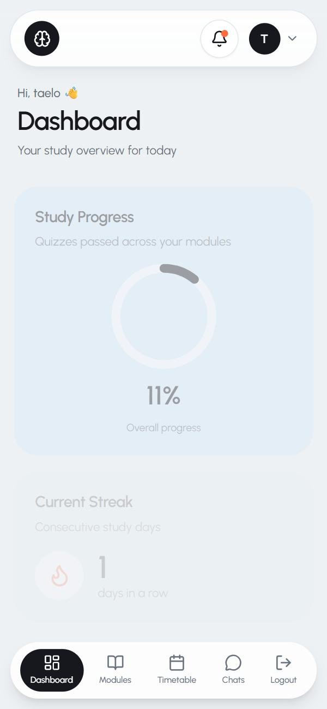<br>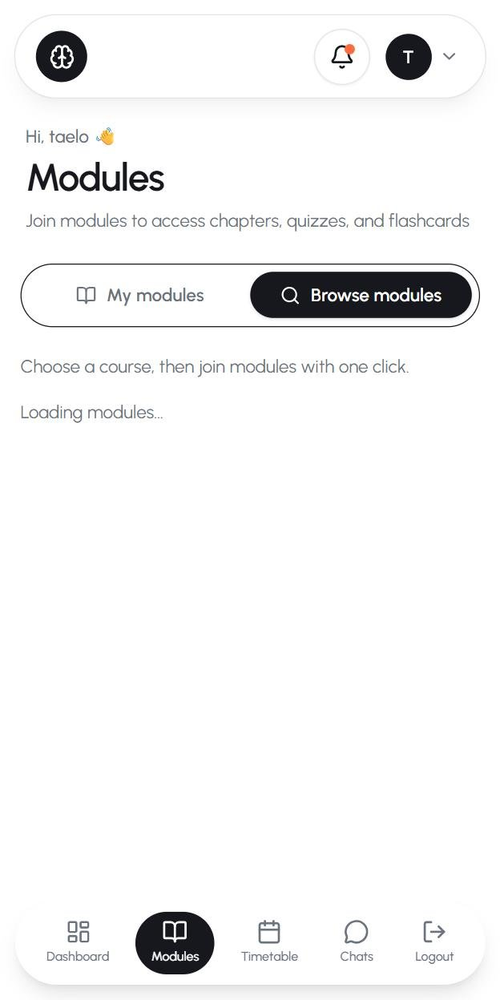</td>
<td>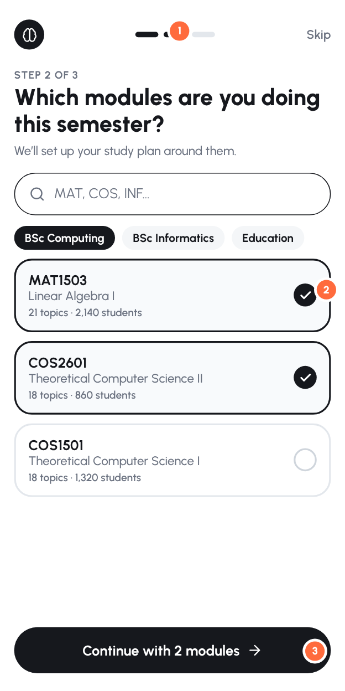</td>
</tr></table>

**What happens now**
- After verifying their email, a student lands on `/dashboard`. The first thing they see is a big **0%** donut, then a streak of 1, then (below the fold on a phone) "No topics scheduled yet. Join a module to get started."
- Getting started means: tap Modules → wait (the Browse tab showed "Loading modules…" as plain text for over 2 seconds) → choose a course chip → scroll a long catalogue → tap **Join module** on each card. Errors here use the browser's `alert()` pop-up.
- Nothing asks about exam or assignment dates, so the Timetable and "Upcoming Assignments" cards stay empty.

**Why it hurts.** First-session activation is the biggest lever for retention. A student who hasn't joined a module and *passed one quiz* in their first visit has no reason to come back. Every extra screen in that path loses people.

**Change: a 3-step onboarding (one screen per step)**
1. **Progress dots + Skip.** A short flow, with Skip available so nobody feels trapped.
2. **"Which modules are you doing this semester?"** Search by code ("MAT", "COS"), course chips, tap to tick, then one **Continue** for all of them, instead of joining modules one at a time on separate cards. Show social proof ("2,140 students"), which you can already count from enrolments.
3. **Sticky Continue button** at the bottom of the screen.
- Step 3 (not drawn): "When is your exam / next assignment?" (prefill known UNISA dates per module if you have them) and "How much can you study a day?" (5 / 15 / 30 min). These feed the daily goal and reminders.
- Finish with **"Start your first lesson"**, going straight into topic 1 of the first module. The aim is a passed quiz within about 10 minutes of signing up.

*Code:* `src/app/(auth)/register/page.tsx` (after `verify()` redirect to `/welcome` instead of `/dashboard`), new `src/app/(dashboard)/welcome/`, reuse the joining logic from `components/modules/module-catalog.tsx`. Add a `onboardedAt` column to `User` so it only shows once.

---

## 2. Dashboard: the next step is buried

<table><tr>
<th width="50%">Now</th><th width="50%">Should be</th></tr><tr>
<td><br>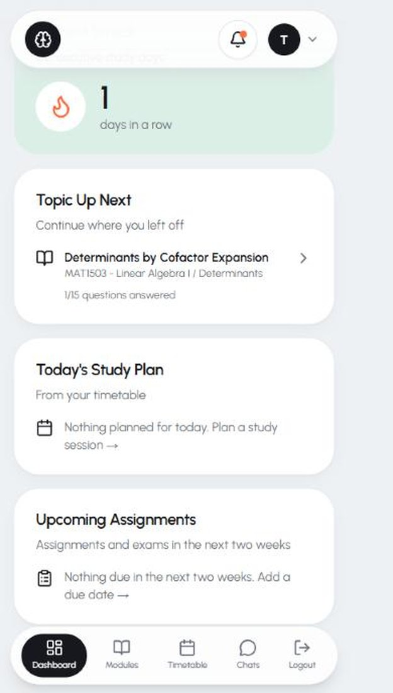</td>
<td>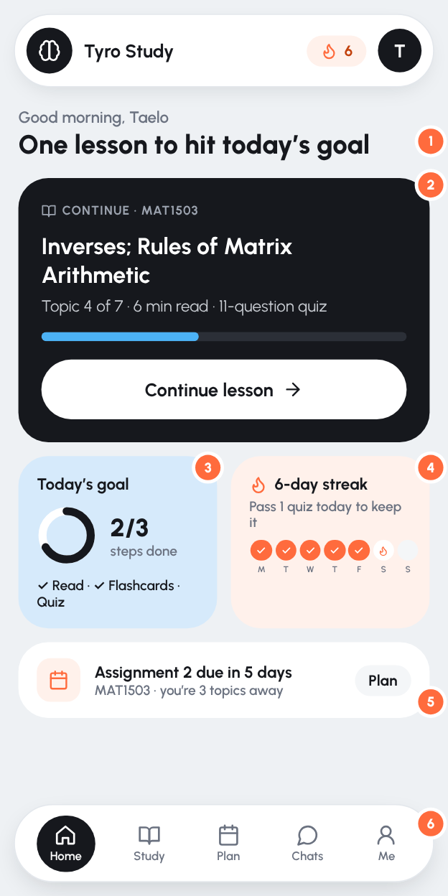</td>
</tr></table>

**What happens now**
- Card order is: Study Progress (donut) → Current Streak → **Topic Up Next** → Today's Study Plan → Upcoming Assignments. On a phone the student has to scroll past two "stats" cards to reach the one thing they can *do*.
- "Topic Up Next" is a small text link ("1/15 questions answered") rather than a clear button.
- The two empty-state cards ("Nothing planned for today", "Nothing due in the next two weeks") take up half the screen for new users.

**Change**
1. **The headline tells you what to do today** ("One lesson to hit today's goal"), not "Dashboard / Your study overview for today".
2. **A big "Continue" card at the top**: module, topic, "Topic 4 of 7 · 6 min read · 11-question quiz", a progress bar and one large **Continue lesson** button. This is the single most important element in the app.
3. **Daily goal ring**: Read → Flashcards → Quiz for today. Small, achievable, and done in one sitting.
4. **The streak card shows the week** (Mon–Sun dots) and what keeps it alive ("Pass 1 quiz today to keep it").
5. **One due-date nudge**, only when there is one, tied to progress ("you're 3 topics away").
6. **Bottom nav: Home · Study · Plan · Chats · Me.** Logout moves into Me (see §9).
- Hide empty cards for new users, or replace them with one "Add your assignment dates" prompt.

*Code:* `src/app/(dashboard)/dashboard/page.tsx` (reorder the widgets, add the hero card). The data for the hero already exists in `getTopicUpNext()`.

---

## 3. Bug: "Up Next" sends students to a locked topic

<table><tr>
<th width="50%">Dashboard says "Up Next: Determinants by Cofactor Expansion"…</th><th width="50%">…tapping it gives a lock screen</th></tr><tr>
<td></td>
<td>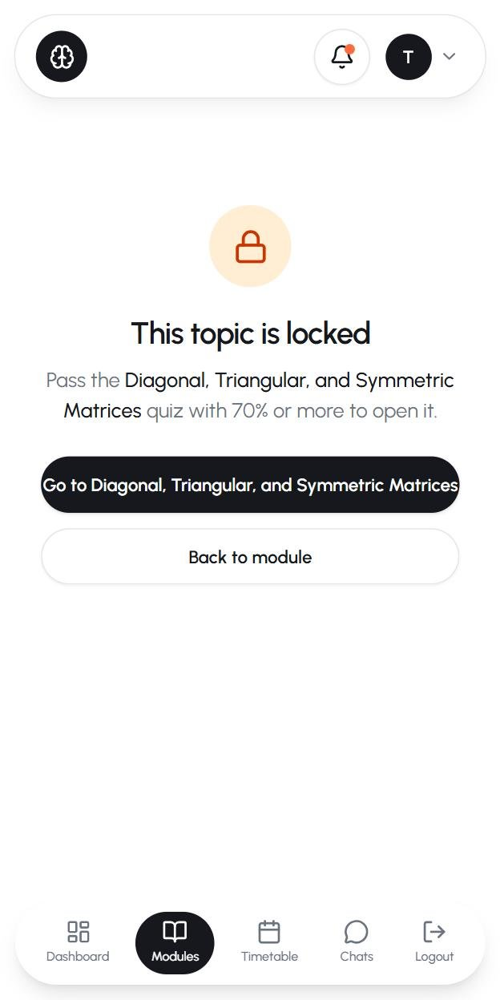</td>
</tr></table>

**What happens now.** In the test account, "Topic Up Next" pointed at *Determinants by Cofactor Expansion* (chapter 2). That topic is locked: the student still has to pass *Inverses*, *Elementary Matrices*, *Further Results* and *Diagonal, Triangular and Symmetric Matrices* in chapter 1. `getTopicUpNext()` in `dashboard/page.tsx` picks "the first topic with some answers but under 70% answered", and it ignores topic locks and quiz passes. A student who answered one question in a later topic gets sent there.

**Change.** "Up next" should be **the first unlocked topic whose quiz isn't passed yet**, in module → chapter → topic order. You already work this out for locks in `src/lib/topic-locks.ts` and for passes in `src/lib/quiz-stats.ts`, so reuse them rather than the raw "answered" count. Add a test: "up next is never locked".

---

## 4. Module and chapter pages: lists of lists, with no sense of a path

<table><tr>
<th>Now: module</th><th>Now: chapter</th><th>Now: later chapter</th><th>Should be</th></tr><tr>
<td>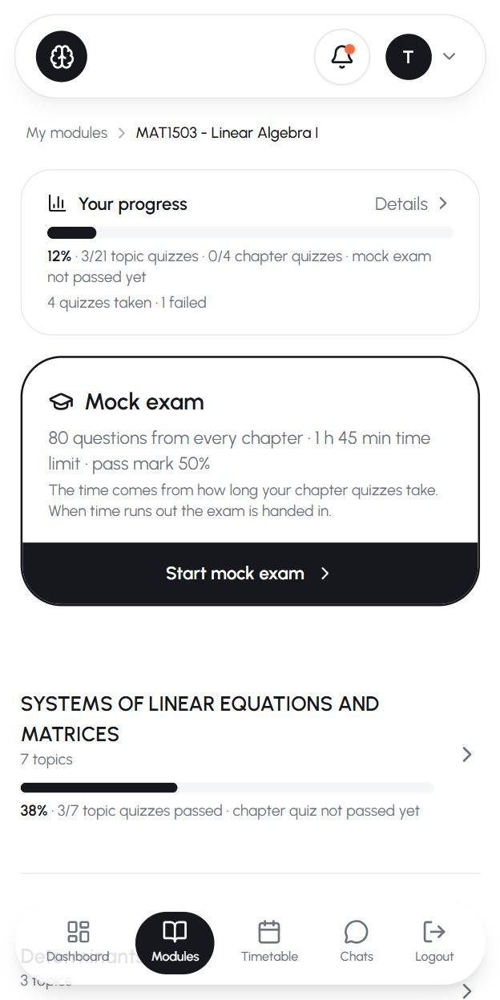</td>
<td>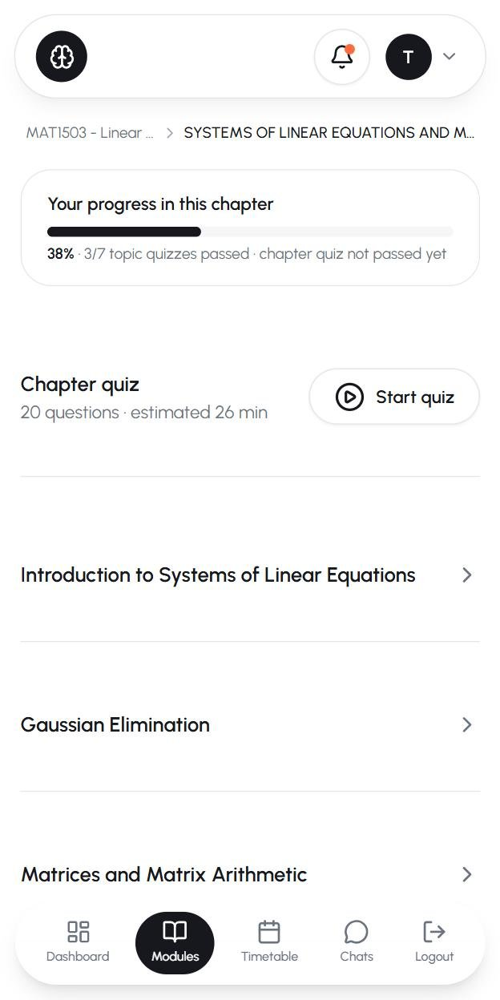</td>
<td>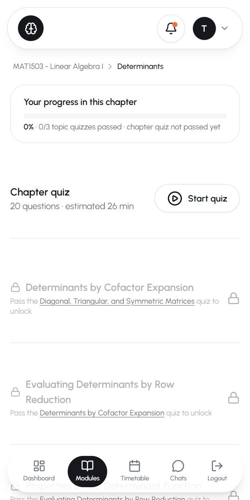</td>
<td>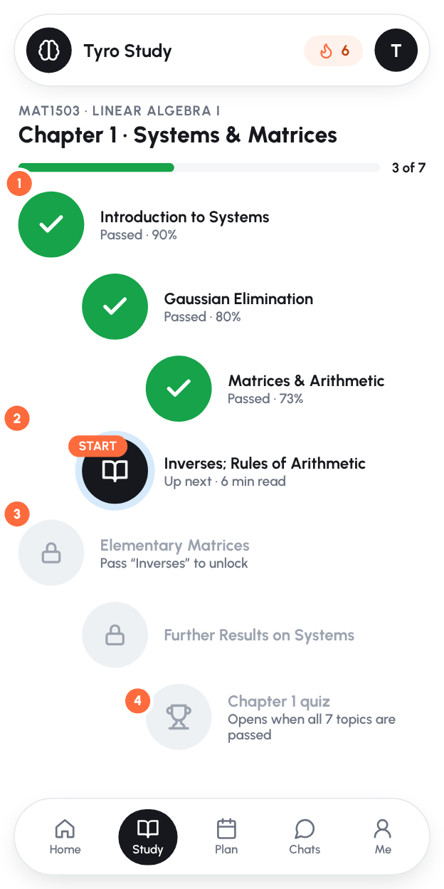</td>
</tr></table>

**What happens now**
- Module page: a progress card, then a large **Mock exam** card, then chapters. Students see an 80-question, 1 h 45 min exam before they've finished topic 1.
- Chapter page: **Chapter quiz · Start quiz** comes *before* the topics. In chapter 2 every topic is locked, yet the chapter quiz is still offered at the top.
- The topic rows show **only a title**: no ✓ for passed, no score, no "you are here". Rows are about 190 px tall on a phone, so you see about 3 topics per screen.
- Locked topics are greyed out (55% opacity) and look broken, not "coming next".
- The breadcrumb shortens to "MAT1503 - Linear … > SYSTEMS OF LINEAR EQUATIONS AND M…", and the shouty ALL-CAPS chapter titles come straight from the textbook.
- There's already a nicer topic list with status icons and progress bars in `components/modules/topic-list.tsx`, but **none of the student pages use it**.

**Change: show the chapter as a path**
1. **Chapter title + "3 of 7" progress** at the top. Put chapter titles in Title Case when importing.
2. **Passed topics show a green ✓ and their best score.** This shows the student how far they've come.
3. **Exactly one "current" node** (black, with a soft ring and a START label) showing what to do next and how long it takes.
4. **Locked topics look like what's coming next**, not like errors, with a short reason ("Pass 'Inverses' to unlock"). The **chapter quiz is the trophy at the end of the path**, and the mock exam at the end of the module, both shown as "opens when…" until they're available.
- Keep the module page as a short list of chapters, each with its own mini path or progress ring. Tapping a chapter opens its path.

*Code:* `modules/[id]/page.tsx`, `modules/[id]/chapters/[chapterId]/page.tsx` (reuse ideas from `topic-list.tsx`, then delete whichever version you don't keep).

---

## 5. "My modules": Leave is as big as Open

<table><tr>
<th width="50%">Now</th><th width="50%">Should be</th></tr><tr>
<td>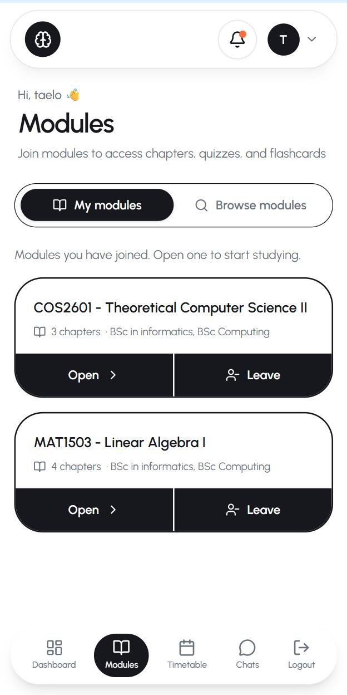<br>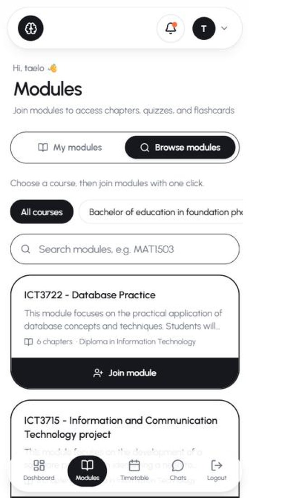</td>
<td>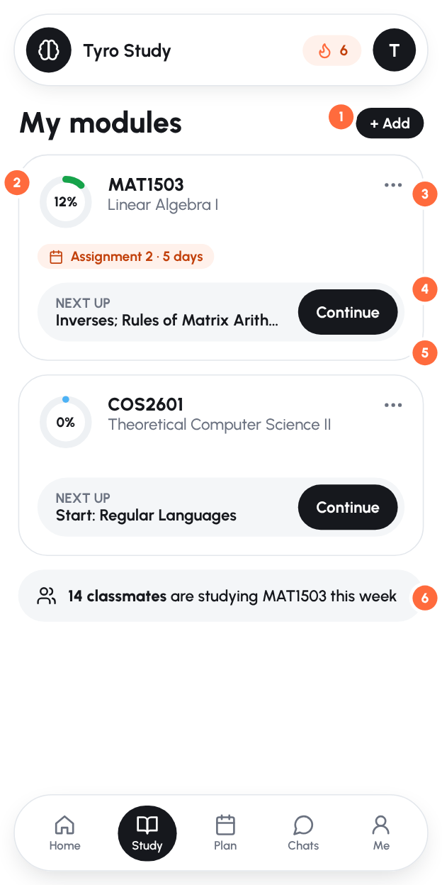</td>
</tr></table>

**What happens now**
- Each joined module has two equal black buttons: **Open** and **Leave**. Leaving is a rare, destructive action, but here it's half of the card. It's confirmed with a browser `confirm()` pop-up.
- The card shows "3 chapters · BSc in informatics, BSc Computing" but not progress (it loads separately and wasn't visible in testing) or what's next.

**Change**
1. **"+ Add"** in the header replaces the separate Browse tab. Joining happens in the onboarding picker (§1).
2. **A progress ring** on every card.
3. **Leave moves into a ⋯ menu** with a proper confirmation sheet ("Your progress is kept").
4. **"Next up" + Continue** on each card, so a tap goes straight into studying.
5. **Due-date chip** pulled from the timetable.
6. **Social proof**: "14 classmates are studying MAT1503 this week" (from enrolments and activity), with a link into Chats.

*Code:* `components/modules/module-catalog.tsx`, `components/modules/modules-tabs.tsx`.

---

## 6. The lesson: a long scroll with the quiz button at the very bottom

<table><tr>
<th width="50%">Now</th><th width="50%">Should be</th></tr><tr>
<td>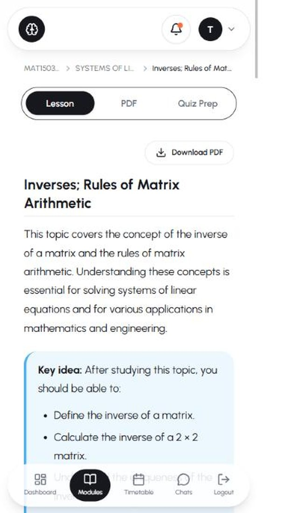</td>
<td>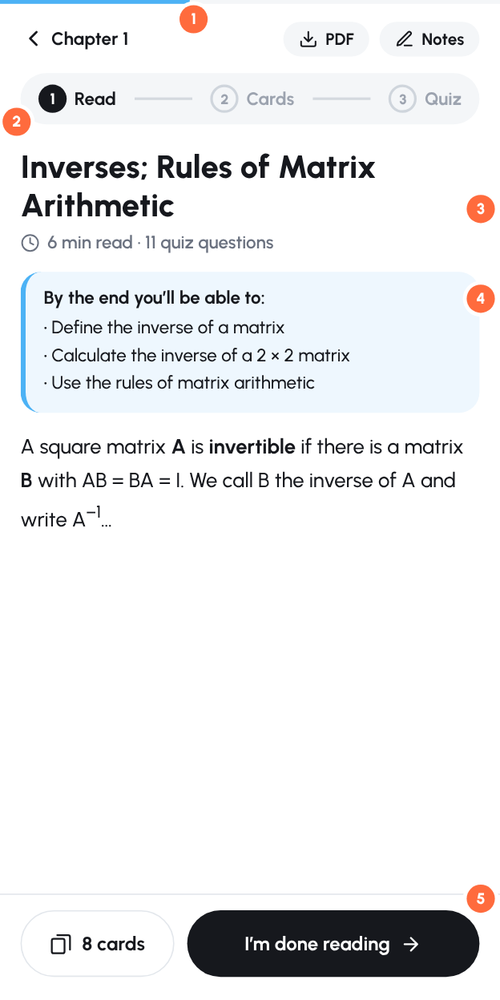</td>
</tr></table>

**What happens now**
- The *Inverses* lesson is about 470 words with 11 headings and is about 6.5 phone screens tall. The only "take the quiz" button is at the very end. Halfway down, students don't know how much is left or what comes after.
- Tabs (Lesson · PDF · Quiz Prep) look like equal choices. In practice the order is read → flashcards → quiz, but nothing says so.
- No reading time and no sign of how far you've read.

**Change**
1. **A thin reading-progress bar** under the status bar.
2. **Back to the chapter, plus PDF and Notes as small chips** (PDF download is already built).
3. **Steps instead of tabs**: Read → Cards → Quiz, showing which step you're on.
4. **"6 min read · 11 quiz questions"** and "By the end you'll be able to…" at the top, so students know what's expected (the content already has a "Key idea" block, so just move it up).
5. **A sticky bottom bar** inside lessons: "8 cards" + **"I'm done reading →"** (goes to flashcards if there are any, otherwise to the quiz). Hide the main bottom nav while reading.
- Move the Video and PDF tabs into the lesson as inline sections or chips, rather than competing tabs.

*Code:* `modules/[id]/topics/[topicId]/page.tsx` (the `Tabs` section and `quizCard`).

---

## 7. The quiz: the Submit button is hidden on phones

<table><tr>
<th width="50%">Now: "Submit" is behind the nav bar, next to Logout</th><th width="50%">Should be: focus mode</th></tr><tr>
<td>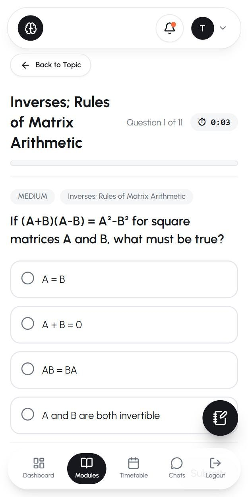</td>
<td>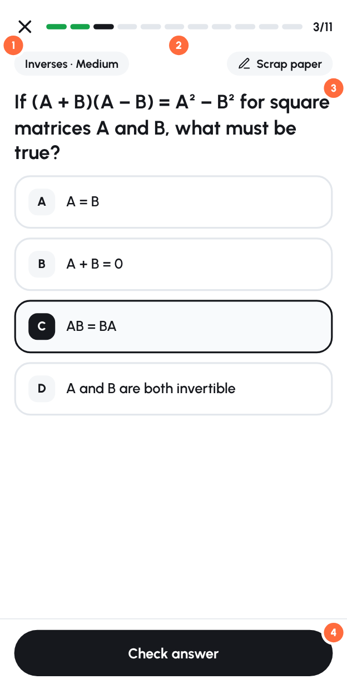</td>
</tr></table>

**What happens now**
- The bottom navigation stays on screen during a quiz. The **Submit** button sits underneath it (you can see "Subm…" behind *Logout*), so students have to scroll, or they tap the wrong thing.
- The floating scrap-paper button covers the right side of option D.
- The topic title fills about a quarter of the screen ("Inverses; Rules of / Matrix / Arithmetic") and is repeated in a chip below.
- A running stopwatch (⏱ 0:03) adds pressure to a practice quiz.

**Change: quiz "focus mode"**
1. **✕ to exit** (with "Your answers so far are saved"), and **no bottom nav** while a quiz is open.
2. **Segmented progress**: one segment per question, coloured green or red as you go, with "3/11".
3. **Scrap paper moves into the header** as a chip, so it never covers an answer.
4. **A sticky "Check answer" button** at the bottom of the screen, where thumbs are. Use A/B/C/D letter badges so options are easy to tell apart and talk about in Chats.
- Keep the timer for mock exams. For topic quizzes, hide it by default and show the time on the results screen instead.

*Code:* `components/quiz/quiz-runner.tsx` (lines ~662–829), `components/layout/mobile-nav.tsx` (hide on `/quiz` and `/mock-exam` routes), `components/quiz/scratch-pad.tsx`.

---

## 8. After an answer: tell students *why*

<table><tr>
<th width="50%">Now (from the code: "✓ Correct! Well done." / "✗ Not quite. The correct answer is highlighted in green.")</th><th width="50%">Should be</th></tr><tr>
<td></td>
<td>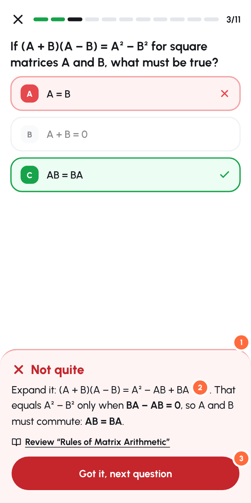</td>
</tr></table>

**What happens now.** A wrong answer turns red, the right one turns green, and the message says only that the right answer is highlighted. The student knows *that* they were wrong but not *why*. The "missed notes" on the results page help, but they come too late, after all 11 questions.

**Change: a feedback sheet that slides up after each answer**
1. **"Not quite" (or "Nice!")** with colour and an icon, plus an optional sound or vibration.
2. **A two-line explanation** of the reasoning. You already generate notes for missed questions (`lib/ai/question-notes.ts`), so generate an explanation per question once and store it on the `Question`, with a short "why each wrong option is wrong" where useful.
3. **"Review: Rules of Matrix Arithmetic"** links straight to the right section of the lesson, then a big **Got it, next question** button.

---

## 9. Results: passing should feel like winning

<table><tr>
<th width="50%">Now (from the code)</th><th width="50%">Should be</th></tr><tr>
<td>

```
        📊
   Quiz Results
  ⏱ Time taken: 4:12
      9/11
   82% · Passed
 ▓▓▓▓▓▓▓▓▓▓▓░░
Excellent! You've mastered this! 🎉
 [Next topic: …]  [Take Quiz Again]
 [Back to Topic]
```
Same 📊 header whether you pass or fail. Three buttons.
</td>
<td>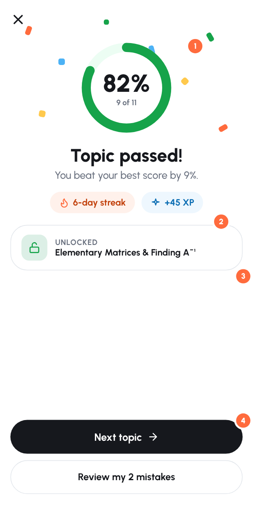</td>
</tr></table>

**Change**
1. **Celebrate a pass**: confetti or a short animation, plus a big ring with the score. A fail gets a kind, specific screen ("So close: 2 more right answers would pass") with **Review mistakes** as the main button.
2. **Show what you gained**: "You beat your best score by 9%", streak kept, XP.
3. **Show what it unlocked**: "Unlocked: Elementary Matrices". This makes the lock system feel like progress instead of a barrier.
4. **One main button (Next topic)**, plus one secondary button (Review my 2 mistakes). Move "Take quiz again" into the review screen.

*Code:* `components/quiz/quiz-runner.tsx` (lines ~400–560). `nextStep` already gives you the next topic and whether it's locked.

---

## 10. Navigation and smaller fixes

| Now | Change | Where |
|---|---|---|
| **Logout** takes one of the 5 bottom-nav slots, so a mis-tap logs the student out. Profile only exists in the avatar menu. | Replace with **Me** (profile, level, notifications, logout). Rename Modules → **Study** and Timetable → **Plan** to shorten the labels. | `lib/navigation.ts`, `mobile-nav.tsx` |
| Flashcards and Assignments are commented out of the nav. Flashcards only exist inside a topic tab. | Add **"Review cards"** to the dashboard daily goal and use spaced repetition (show cards that are due). This is the best reason to open the app for 5 minutes a day. | `lib/navigation.ts`, new `/review` page |
| Loading states are plain text ("Loading…", "Loading modules…"), seen for over 2 s on Browse. | Use skeleton cards (there's a `components/ui/skeleton.tsx`), and fetch on the server where pages are client-only today (`modules/[id]`, chapter page). | module, chapter, topic pages |
| `alert()` and `confirm()` used for join, leave and assignment errors (7 places in student pages). | Use the existing toast (`hooks/use-toast`) and a confirmation sheet. | `module-catalog.tsx`, `modules/[id]/page.tsx`, topic page |
| The notification bell shows an orange dot until push is enabled, which feels like an unread alert. | Ask at a meaningful moment ("Remind me to keep my streak at 19:00?") after the first passed quiz, and remove the permanent dot. | `top-nav.tsx` |
| "Hi, taelo 👋" uses the lowercase name as typed, and the name is optional at sign-up. | Capitalise for display, and ask for a first name in onboarding. | `components/layout/header.tsx` |
| The top bar on phones shows only the logo, bell and avatar, with no page title. | Put the streak chip in the top bar (see mockups) so it's visible on every page. | `top-nav.tsx` |
| Assignment upload modal: "PLEASE WAIT WHILE WE PROCESS YOUR SUBMISSION…" in caps, "YOU SHOULD WORK ON", and two floated buttons. | Use sentence case, a progress indicator and the same result layout as quiz results. | topic page (`Modal` section) |

---

## 11. Making it fun (without making it childish)

The audience is mostly adult distance learners studying around work and family. Keep the fun **quiet and respectful**: reward consistency and progress, never shame.

- **Daily goal (Read → Cards → Quiz)** sized to the minutes chosen in onboarding. Completing it fills the ring, with a small celebration.
- **The streak counts study, not visits.** Today `lib/streak.ts` adds a day whenever any dashboard page loads (`app/(dashboard)/layout.tsx`). Count a day only when the student finishes a lesson or passes a quiz. Add **one free "streak freeze" a week**, because adults miss days and losing a 20-day streak makes people quit.
- **XP** for each correct answer, a bonus for a first-try pass, and weekly totals. Let students opt in to a **friends leaderboard** among the people they chat with. You already have friends and chat, which most study apps don't.
- **Reminders that mean something**, using the push notifications you already have: "Your streak ends at midnight: one 6-minute lesson keeps it", "Assignment 2 is due Friday and you're 3 topics away". Keep it to at most one a day, at the time the student chose.
- **Milestones** such as a chapter completed, the mock exam passed, or a 7- or 30-day streak, each with a shareable card ("I passed the MAT1503 mock exam on Tyro Study") for WhatsApp. This also brings in new students.
- **Small touches**: a short sound or vibration on correct answers (with a mute option), a progress ring that animates, and "Welcome back, you left off at…" after 3 or more days away.

---

## 12. Measure it

Add simple event tracking (Vercel Analytics custom events or PostHog) so you can see whether the changes work:

| Metric | Definition | Target to aim for |
|---|---|---|
| **Activation** | % of new sign-ups who pass their first topic quiz within 24 h | 40%+ |
| **Day-1 / Day-7 return** | % of new students who come back the next day / within the next 7 days | 30% / 20%+ |
| **Weekly active learners** | Students who complete at least one lesson or quiz in a week (not just visits) | Rising week on week |
| **Funnel drop-off** | Sign-up → module joined → lesson opened → quiz started → quiz passed | Find the biggest drop and fix it first |

---

## Suggested order of work

**This week (quick wins, mostly small)**
1. Fix "Up Next" so it respects locks (§3).
2. Quiz focus mode: hide the bottom nav on quiz pages, sticky Check button, move scrap paper (§7).
3. Move the "Continue" card to the top of the dashboard as a big button (§2).
4. Replace Logout in the bottom nav with Me (§10).
5. Move Leave into a ⋯ menu (§5).
6. Separate pass and fail result screens with one main button (§9).

**Next 2 weeks**
7. Onboarding flow (§1).
8. An explanation for every question (§8). Batch-generate them with the AI pipeline you already have.
9. Chapter path view with per-topic status (§4).
10. Lesson steps and sticky bottom bar (§6).
11. The streak counts study, plus a weekly freeze (§11).
12. Event tracking (§12).

**After that**
13. Daily goal, XP, reminders, and a review-cards (spaced repetition) page.
14. Friends leaderboard and shareable milestone cards.
15. Skeleton loading states, and fetching on the server for the module, chapter and topic pages.

---

### Appendix: screens captured

| File | Screen |
|---|---|
| `images/current/01-landing.jpg` | Public home page (signed out) |
| `images/current/02-notes.jpg` | Public study notes index |
| `images/current/03-login.jpg` | Sign in |
| `images/current/04-dashboard-top.jpg` / `05-dashboard-below.jpg` | Dashboard, top and scrolled |
| `images/current/06-modules-mine.jpg` | My modules |
| `images/current/07-modules-browse-loading.jpg` / `08-modules-browse.jpg` | Browse modules (loading, loaded) |
| `images/current/09-module-page.jpg` | MAT1503 module page |
| `images/current/10-chapter-all-locked.jpg` | Chapter 2, every topic locked but the chapter quiz is offered |
| `images/current/11-topic-locked.jpg` | Lock screen reached from the dashboard's "Up Next" |
| `images/current/12-chapter-topics.jpg` | Chapter 1 topic list |
| `images/current/13-lesson.jpg` | Lesson page |
| `images/current/14-quiz-question.jpg` | Quiz question, with Submit hidden behind the nav |
